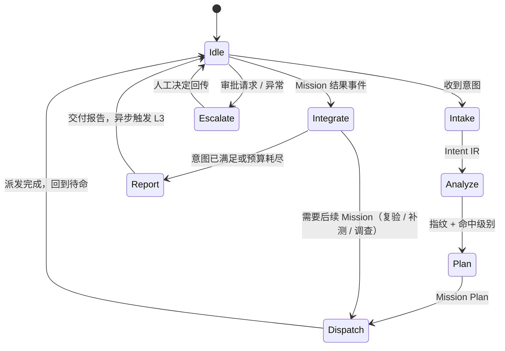
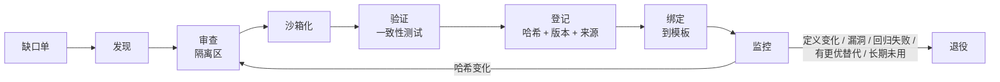
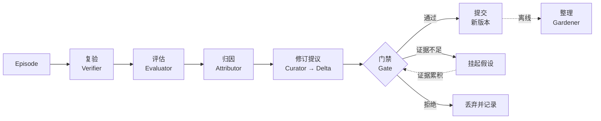
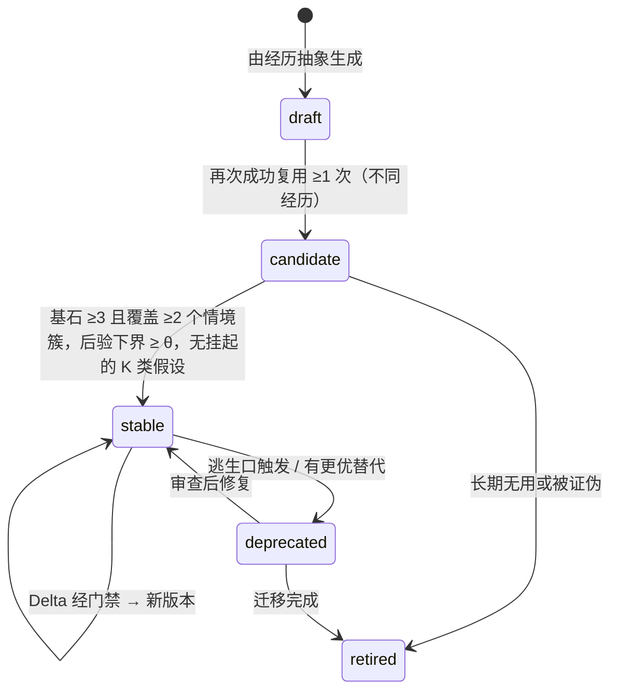
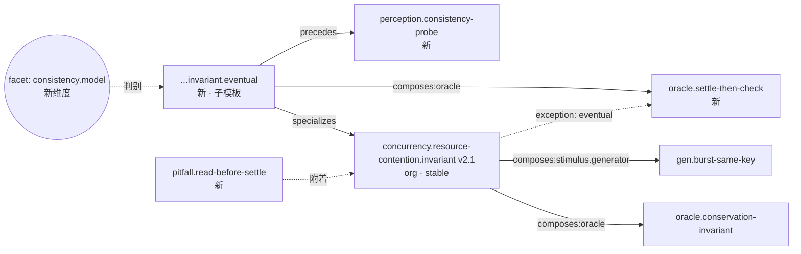

# Agent Core 设计文档

> **状态**：草案 v0.2（v0.2：并入测试 Agent 与自适应系统调研——失败分诊、判决语义、预言自检、横切契约）　｜　**日期**：2026-10-20　｜　**范围**：自主演化型软件测试 Agent 的核心（Core）
> **读者**：架构设计者、Core 实现者
> **标注约定**：【决策】已确定；【建议】推荐默认值，可调整；【待定】需要进一步讨论

---

## 0. 阅读指引

| 章节 | 内容 |
|---|---|
| §1–§3 | 问题、目标、原则、术语 |
| §4–§5 | 总体架构（三环模型）、角色与调度协议 |
| §6 | 意图与情境（Intent IR、情境指纹） |
| §7–§8 | **模板模型**与**模板图**（知识网络） |
| §9 | 能力层：工具 / Skill / MCP 的获取与**渐进式披露** |
| §10 | **反馈与演化**：本设计的心脏 |
| §11–§13 | 安全治理、失效模式、冷启动 |
| §14 | 贯穿示例：一个模板从诞生到稳固 |
| §15–§17 | 度量、参考实现映射、开放问题 |

---

## 1. 背景、目标与边界

### 1.1 问题

现有"LLM + 软件测试"的方案大多是以下三种形态之一：

1. **固定流程型**：为某一测试类型（单测生成、Web UI 回归、API 冒烟……）写死的流水线。换一个方向就要重写一套。
2. **堆砌型**：把大量提示词、工具、Skill 一次性挂载，依赖模型现场判断。上下文膨胀，工具数量一多选择准确率就下降，经验无法沉淀。
3. **流水账记忆型**：把历史对话或摘要存起来供检索。经验是无结构、无边界、无纠错的文本，越用越乱。

本 Core 要解决的是：**让"测试能力"本身可以被学习、沉淀、组合与纠错**。

### 1.2 设计目标

| # | 目标 | 说明 |
|---|---|---|
| G1 | 意图驱动 | 测试人员只用自然语言表达测试意图，Core 负责把它变成可执行、可验证的测试任务 |
| G2 | 方向开放 | 不预设测试类型；功能、接口、UI、性能、安全、模糊、兼容、数据/模型等方向都通过**同一套机制**被学会 |
| G3 | 自主探索 | 面对未知意图或未知被测对象，能自行调研测试方法、方案与工具，并自行构建、获取、验证所需能力 |
| G4 | 经验结构化 | 每次任务后，把经历抽象为模板，进入**可引用、可继承、可组合**的模板图 |
| G5 | 闭环纠错 | 正反馈强化与泛化；负反馈被解释为"适用边界信息"，用来修正边界；模板越用越稳固 |
| G6 | 上下文经济 | 工具与 Skill 只在模板被激活时渐进披露；全局只暴露极少的元工具 |
| G7 | 安全可控 | 沙箱内自主，风险分级审批；自我演化不触碰安全内核 |

### 1.3 非目标

- **不是测试框架**：不替代 pytest、Playwright、k6 等；Core 学习的是**何时、如何使用它们**。
- **不替代人对业务优先级的判断**：Core 把假设显式写进报告，供人审阅。
- **v0.x 不做模型微调**：学习全部发生在外部知识（模板图）与能力库中，即"不微调模型的智能体学习"路线。

### 1.4 已确定的前提【决策】

| # | 议题 | 决定 | 对设计的影响 |
|---|---|---|---|
| D1 | 落地底座 | 框架无关 + 参考映射 | 正文只定义协议与数据模型；§16 给出到 Claude Agent SDK 的参考映射 |
| D2 | 反馈来源 | **全自动闭环** | 必须建立"反馈可信度层"，防止自我强化的错误奖励（§10.3） |
| D3 | 知识范围 | 分层共享：全局 → 组织 → 项目 | 层叠覆盖、晋升/下沉、脱敏（§8.2） |
| D4 | 自主度 | 沙箱全自主 + 风险分级审批 | 风险等级 R0–R4，由内核在模型之外强制执行（§11.1） |

---

## 2. 设计原则

| # | 原则 | 含义 |
|---|---|---|
| P1 | **知识即产品** | 一次测试任务有两个产出：测试结论（给人）与知识增量（给系统），缺一不可 |
| P2 | **负反馈是边界信息** | 失败首先意味着"用错了地方"。先修边界，不先改内容，更不直接删除；只有在多样情境下一致失败，才质疑内容本身 |
| P3 | **证据优先于声明** | Agent 的自我报告不是奖励；只有可独立复验的证据才能进入反馈 |
| P4 | **职责分离** | 执行者不评判自己；评判者不修改知识；修改知识者不能修改内核 |
| P5 | **最小预定义，最大自演化** | 内核只提供机制（元工具、协议、安全），策略全部来自学习 |
| P6 | **渐进披露** | 上下文是预算；Agent 每一步看到的都是"当前这一步需要的最小知识" |
| P7 | **增量演化** | 知识以结构化增量（Delta）更新，禁止整体重写，避免"上下文坍缩"与"简短化偏置" |
| P8 | **稳定与可塑兼顾** | 越成熟的模板越难被单次证据改变（变更阻尼）；所有变更可回放、可回滚 |
| P9 | **显式不确定性** | 每个模板、每条结论都带置信度与证据引用；不确定区就是探索区 |
| P10 | **内核不可变** | 可被学习修改的范围（学习面）被显式划定；安全策略、评判器、元工具不在其中 |

---

## 3. 术语表

| 术语 | 定义 |
|---|---|
| 测试意图 Intent | 测试人员的自然语言请求，解析后形成 Intent IR（§6.1） |
| 被测对象 SUT | System Under Test |
| 情境指纹 Situation Fingerprint | 描述 SUT、环境、目标与约束的结构化特征集合，用于判定模板的适用边界（§6.3） |
| 维度词表 Facet Vocabulary | 情境指纹的维度集合；**可生长**，负反馈可以为它新增维度 |
| 模板 Template | 可复用的测试知识单元，有多种类型（策略、技术、预言、环境、感知、能力配方、元模板、反模式） |
| 测试七要素 + 横切契约 | 七要素：模型、假设、激励、预言、观测、环境、充分性，描述测试语义，是模板的槽位；五项横切契约：适用边界、判决语义、控制策略、证据契约、授权约束（§7.1） |
| 模板图 Template Graph | 模板、能力、经历之间的有类型关系网络，即 MAPE-K 中的 K |
| 适用边界 Applicability | 模板何时适用的可学习判定：硬条件 + 软条件 + 例外树（§7.4） |
| 任务 Mission | 主 Agent 派发给任务 Agent 的一次有边界的工作单元 |
| 经历 Episode | 一次 Mission 的完整可追溯记录：计划、动作、偏离、证据、结果、归因 |
| 能力 Capability | 抽象能力契约（如 `cap:load.generate.http`），由具体提供者实现 |
| 提供者 Provider | 实现能力的具体工具：MCP Server、Skill、CLI、脚本 |
| 证据契约 Evidence Contract | 模板声明的"如何客观验证我这次做得好不好" |
| 归因 Attribution | 把一次结果（尤其是失败）定位到具体原因与具体节点 |
| 基石案例 Cornerstone Case | 支撑某条适用规则成立的历史成功经历；修改规则时必须保持它们的判定不变 |
| 学习面 Learning Surface | 允许被演化修改的对象集合 |

---

## 4. 总体架构

### 4.1 分层视图

```
┌────────────────────────────────────────────────────────────────────────┐
│  测试人员  ── 自然语言意图 ──▶            ◀── 报告 / 审批请求 ──          │
└────────────────────────────────────────────────────────────────────────┘
┌─────────────────────────── 控制面 Control Plane ───────────────────────┐
│  主 Agent（Orchestrator）：意图解析 · 情境分析 · 组合规划 · 派发 · 待命 · 汇总 │
└────────────────────────────────────────────────────────────────────────┘
          │ Mission Spec                                   ▲ Result Envelope
          ▼                                                │
┌─────────────────────────── 执行面 Execution Plane ─────────────────────┐
│   Scout 侦察     Toolsmith 工匠     Executor 执行     Verifier 裁判       │
│   每个 Mission Agent 内部运行 OODA 战术环；可按模板子树分叉子 Agent        │
└────────────────────────────────────────────────────────────────────────┘
          │ Episode / Evidence                             ▲ 渐进披露（模板 / 能力）
          ▼                                                │
┌─────────────────────────── 知识面 Knowledge Plane（K）──────────────────┐
│   模板图 Template Graph      能力注册表 Capability Registry               │
│   经历库 Episode Store       维度词表 Facet Vocabulary    SUT 模型缓存    │
└────────────────────────────────────────────────────────────────────────┘
          ▲ Template Delta（受控写入）
          │
┌─────────────────────────── 学习面 Learning Plane ──────────────────────┐
│   Evaluator 评估   Attributor 归因   Curator 策展   Gardener 园丁         │
└────────────────────────────────────────────────────────────────────────┘
┌─────────────────────────── 内核 Kernel（Agent 不可修改）────────────────┐
│  元工具 · 策略引擎/风险分级 · 沙箱 · 审计日志 · 证据存储 · 版本库 · 预算器  │
└────────────────────────────────────────────────────────────────────────┘
```

### 4.2 三环模型

Core 的控制结构由三个嵌套的环组成，分别借鉴 OODA、MAPE-K 与**双环学习**（Argyris & Schön）：

| 环 | 借鉴 | 时间尺度 | 运行位置 | 改变的对象 |
|---|---|---|---|---|
| **L1 战术环** | OODA | 秒～分钟，单步 | 每个 Mission Agent 内部 | 下一步动作 |
| **L2 任务环** | MAPE-K | 一次意图 | 主 Agent + 派发的 Mission | 测试计划与执行 |
| **L3 演化环** | 双环学习 + CBR 4R | 任务结束后 / 离线周期 | 学习面 | **知识 K 本身**（模板、边界、组合、绑定） |

- L1、L2 是**单环学习**：在既有知识下把事情做对。
- L3 是**双环学习**：修正指导行为的知识本身，也就是修正"怎样算做对"的规则。
- 三环共享同一个知识库 K。

**与自适应系统研究的对应**：

- **分层控制**：主 Agent 负责分析与规划，Mission Agent 负责监控与执行，这是去中心化 MAPE-K 中的**主从模式**（Weyns 等）。Mission Agent 内部又有自己的修复与 OODA 循环，整体构成**分层控制**。因此每个内环都必须有显式的预算与停止条件（模板的 `control` 契约，§7.1）。
- **反思与充实**：经典 MAPE-K 被批评为集中式、只会被动响应。近年的扩展（如 AWARE）增加了 Reflect（反思）与 Enrich（充实）阶段。在 Core 中，这两个阶段对应 L3 演化环，以**比任务环更慢的节奏**运行。
- **不确定性**：自适应系统研究强调，知识在达到证据阈值前不应改变。这对应 L3 的门禁（§10.8）。

```
          ┌───────────────────── L3 演化环 ──────────────────────┐
          │   Evaluate → Attribute → Revise → Gate → Retain       │
          └──────────────▲──────────────────────────┬─────────────┘
                         │ Episode                  │ Template Delta
  ┌──────────────────────┴──── L2 任务环（MAPE-K）───┴───────────────────┐
  │   Monitor → Analyze → Plan → Execute ─────────────┐                  │
  │      ▲                                             ▼                  │
  │      │          ┌────── L1 战术环（OODA，每个 Mission 内）──────┐      │
  │      └─ Result ─│   Observe → Orient → Decide → Act             │      │
  │                 └───────────────────────────────────────────────┘      │
  └──────────────────────────────── 共享知识 K ────────────────────────────┘
```

### 4.3 MAPE-K 映射（L2 任务环）

| MAPE-K | Core 中的实现 | 产物 |
|---|---|---|
| **Monitor** | 接收意图；采集 SUT 信号（规格、代码仓、文档、运行实例、CI/缺陷库）；接收 Mission 结果事件 | Intent IR、原始观测 |
| **Analyze** | 构造情境指纹；识别风险与测试目标；在模板图中做适用性匹配，判定命中级别 | 情境指纹、候选模板集、命中级别 |
| **Plan** | HTN 式分解 + 模板组合；分配预算、风险等级、证据契约 | Mission Plan（实例化的模板树） |
| **Execute** | 派发 Mission，随即进入待命 | Mission Spec × N |
| **Knowledge** | 模板图 + 能力注册表 + 经历库 + SUT 模型 | — |

> 经典 MAPE-K 只监控被管系统。这里的"被管系统"有两个：**SUT** 和**测试过程本身**。Core 同时监控两者，后者是 L3 的输入。

### 4.4 OODA 映射（L1 战术环）

Boyd 的 OODA 中最关键的环节是 **Orient（定向）**：观察要经过已有经验、分析与综合，才形成判断。在 Core 中，**被激活的模板就是 Agent 的"定向"**，它决定 Agent 如何解读观察。

| OODA | Mission Agent 中的实现 |
|---|---|
| **Observe** | 读取工具输出摘要、SUT 响应、环境状态。原始数据留在沙箱，只取摘要（§9.4） |
| **Orient** | 将观察与模板的"预期模型"对照：符合预期 → 沿模板推进；偏离 → 分类偏离（SUT 异常？环境异常？模板不适用？） |
| **Decide** | 继续 / 调整参数 / 切换模板分支 / 请求新能力 / 上报 |
| **Act** | 调用能力，记录到 Episode |

两条 Boyd 式路径：

- **隐式引导快速路径**（Implicit Guidance & Control）：情境与模板高度吻合时，Orient 直接驱动 Act，不做额外推理。这是成熟模板带来的"肌肉记忆"，可以显著降低成本。
- **再定向路径**：观察与模板预期的偏离超过阈值时，暂停执行，进入局部探索，并在 Episode 中记录**偏离点**。偏离点是 L3 修正适用边界最有价值的素材。

---

## 5. 角色与调度

### 5.1 主 Agent（Orchestrator）

主 Agent 只做五件事：**理解意图、分析情境、规划组合、派发任务、汇总报告**。
它**不执行测试、不加载工具细节、不修改知识**。上下文中只有：D0 元工具、D1 模板卡片、Mission 句柄与结果摘要。



**待命语义**：

1. 派发后立即回到 Idle，**不轮询**。Mission 结果、审批请求、预算告警、超时都以**事件**唤醒主 Agent。
2. Idle 状态下可以受理新意图；多个意图的 Mission 并行存在，以 `intent_id` 关联。
3. 唤醒时只加载与该事件相关的 Mission 摘要，而不是全部历史（上下文隔离）。

### 5.2 Mission Agent 角色

角色的**职责与权限边界由内核定义**；角色的**工作方法本身也是模板**（元模板，§7.2），同样会演化。

| 角色 | 何时派发 | 职责 | 权限 | 产出 |
|---|---|---|---|---|
| **Scout 侦察** | 未命中或近似命中；需要了解 SUT | 侦察 SUT；调研测试方法、方案与工具；提出策略假设与能力缺口 | 只读 + 联网检索（R0/R1） | 策略假设集、能力缺口单、SUT 模型增量 |
| **Toolsmith 工匠** | 存在能力缺口 | 搜寻、下载、构建、验证工具 / Skill / MCP，并登记到注册表 | 沙箱执行；首次引入外部依赖需审批（R2） | 已验证的 Provider + 一致性测试 |
| **Executor 执行** | 有可执行计划 | 实例化模板树，运行 OODA，产生证据 | 按 Mission 风险等级 | 证据 + 结果信封 |
| **Verifier 裁判** | 每个产生"发现"或"通过"结论的 Mission 之后 | 独立复验发现；评估测试强度（变异 / 金丝雀）；计算客观指标 | 沙箱；与 Executor 上下文隔离 | 评估记录 |
| **Curator 策展** | Mission 闭环后（L3） | 归纳 / 修订模板，产出 Template Delta | 只能写候选区，不能直接修改稳定模板 | Template Delta |
| **Gardener 园丁** | 离线周期 | 去重合并、拆分、提取公共父模板、退役、一致性检查、回放回归 | 同上 + 晋升审核 | 图维护 Delta |

> Evaluator、Attributor 是学习面中以确定性代码为主的组件（LLM 只辅助）；Verifier 是执行面的 Agent。两者配合产生反馈。

### 5.3 调度协议

**Mission Spec（派发信封）**

```yaml
mission_id: m-20261020-0042
intent_id: i-0017
role: executor                      # scout | toolsmith | executor | verifier
objective: "验证下单接口在并发下单场景下是否存在超卖"
plan_ref: plan://i-0017/node/3      # 指向实例化模板树中的子树
templates:                          # 只给 ID，正文在 Mission 内按需披露
  - tpl://org/concurrency.resource-contention.invariant@2.1
scope:
  targets: [https://staging.order.example/api/v1/orders]   # 内核据此生成网络白名单
  data: synthetic-only
risk_tier: R3                       # 由内核判定，Agent 不能自行声明
budget: { wall_clock: 30m, tokens: 400k, cost_usd: 5 }
evidence_contract: ec://concurrency.invariant/v1           # 必须返回的证据种类
return_schema: result-envelope/v1
escalation: { on_scope_change: ask, on_budget_80pct: notify }
```

**Result Envelope（结果信封）**

```yaml
mission_id: m-20261020-0042
status: completed                   # completed | partial | blocked | failed | aborted
claims:                             # 声明，不是事实；需经 Verifier 复验
  - id: c1
    type: defect                    # defect | pass | coverage | observation
    statement: "200 并发下单时库存被扣为 -3"
    oracle: { kind: specified-invariant, strength: high }
    evidence: [ev://m-0042/repro.sh, ev://m-0042/db-snapshot.json]
    reproducibility: "5/5"
goal_coverage:
  下单并发一致性: covered
  取消订单并发: not_covered
deviations:                         # 偏离模板预期之处 —— L3 的关键输入
  - at: step-4
    expected: "压测结束后库存立即可读且一致"
    observed: "库存值在 2s 内持续变化"
    agent_hypothesis: "扣减可能是异步执行"
capability_issues: []
cost: { wall_clock: 18m, tokens: 210k }
self_assessment: { ... }            # 仅供参考，不进入奖励计算（P3）
```

**事件类型**：`mission.completed`、`mission.blocked`、`approval.required`、`budget.threshold`、`mission.timeout`、`capability.acquired`。

### 5.4 分叉与上下文隔离

- 模板树中的每个组合子节点都可以在独立子 Agent 中执行（fork）。子 Agent 结束，其工具与模板正文随之卸载。
- 父子之间只传递结构化信封，不传递原始上下文。
- 嵌套深度与并发数由内核预算器限制【建议】深度 ≤ 3。

---

## 6. 意图与情境

### 6.1 Intent IR（意图中间表示）

主 Agent 把自然语言意图解析成结构化的 Intent IR。之后所有的匹配、规划与评估都基于 IR，不再反复解读原文。

```yaml
intent_id: i-0017
raw: "帮我看看新上线的下单接口在大促并发下会不会超卖"
goal:
  kind: find_defects            # find_defects | assess_quality | regression_guard | compliance_check | explore
  quality_attributes: [correctness.consistency, performance.concurrency]
  hypotheses: ["并发下单导致库存超卖"]
sut_refs:
  - { kind: api, locator: "openapi://order-service/v1", env: staging }
constraints:
  environment: staging          # 生产环境自动升为 R4
  data: synthetic-only
  deadline: 2h
acceptance:                     # 什么算完成
  - "对超卖假设给出有证据支撑的结论（复现 / 在给定强度下未复现）"
assumptions:                    # 系统自行补全的假设，在报告中显式列出
  - "大促并发量按 200 估计（意图未给出）"
open_questions: []
```

**澄清策略**【建议】：反馈全自动（D2）不等于理解意图也全自动。

- 歧义会改变**风险等级或测试范围**（目标环境、是否允许破坏性操作、目标资产）时，必须向人确认。
- 其他歧义由系统按模板默认值补全，记入 `assumptions` 并在报告中显式声明。

### 6.2 SUT 模型

Scout 在侦察中构建 SUT 模型，存在项目层知识中，并标注新鲜度：

- **接口面**：OpenAPI / GraphQL / gRPC 定义、UI 路由与页面结构、CLI、SDK
- **结构面**：代码模块、依赖、部署拓扑、数据存储、消息队列
- **行为面**：状态机、业务不变式、一致性模型（同步 / 异步 / 最终一致）
- **历史面**：缺陷库、变更记录、既有测试资产、CI 结果

SUT 模型是项目层知识，**不会被晋升**到组织层或全局层（§8.5）。它在每次 Mission 开始前做增量刷新，按变更检测哈希比对。这是自适应系统中"运行时模型"（models@run.time）的思想：维护一个随 SUT 变化而同步更新的活模型，而不是一次性的快照。

> **SUT 的输出同样不可信**：被测网页、接口响应、日志中都可能夹带针对 Agent 的指令。Monitor/Observe 阶段把 SUT 输出一律视为数据（§11.2）。

### 6.3 情境指纹（Situation Fingerprint）

情境指纹是**适用边界的坐标系**。每个维度（facet）都带取值、置信度和来源：

```yaml
fingerprint:
  sut.kind:              { value: rest-api,                 conf: 1.0, src: openapi }
  sut.stack:             { value: jvm/spring-boot,          conf: 0.9, src: headers+repo }
  interface.protocol:    { value: http/json,                conf: 1.0 }
  state.shared_resource: { value: true,                     conf: 0.8, src: scout-analysis }
  consistency.model:     { value: unknown,                  conf: 0.0 }   # 未知 → 可能触发探测
  env.kind:              { value: staging,                  conf: 1.0 }
  oracle.availability:   { value: [spec, invariant],        conf: 0.7 }
  goal.kind:             { value: find_defects,             conf: 1.0 }
  quality.attribute:     { value: [correctness.consistency], conf: 1.0 }
```

**维度词表是可生长的**。这是让负反馈能够"说清楚用错在哪里"的前提：

- 如果失败无法用现有维度解释（两次情境在所有已知维度上都相同，结果却相反），Attributor 会提出**新维度假设**。例如"一致性模型：同步 / 最终一致"。Scout 在后续任务中探测这个维度，验证成立后它才进入词表。
- 维度取值支持**层级**，例如 `jvm > jvm/spring-boot > jvm/spring-boot@3`。层级让条件可以在不同粒度上泛化或收窄。
- 维度有类型：枚举、有序、布尔、数值区间、集合。适用条件就是这些维度上的谓词。

### 6.4 命中级别与探索–利用

Analyze 阶段的输出之一是**命中级别**，它决定派发哪种 Mission：

| 级别 | 判定 | 派发 | 成本 |
|---|---|---|---|
| **H3 精确命中** | 存在稳定模板，硬条件全部为真，软匹配高，无例外触发 | Executor 直接执行（隐式引导快速路径） | 低 |
| **H2 适配命中** | 存在适用模板，但有维度为 `unknown` 或落在软边界上 | Executor 先运行模板自带的**前置探测步骤**，再执行；结果标记为"边界探索" | 中 |
| **H1 类比命中** | 只有兄弟或父模板（抽象层）相似 | Scout 短探索 + 基于父模板特化出草案 | 中高 |
| **H0 未命中** | 无相关模板 | Scout 完整探索 → Toolsmith 补能力 → Executor 试验 | 高 |

**探索–利用平衡**【建议】：

- 每个适用模板在每个**情境簇**上维护 Beta 后验，用汤普森采样排序。
- 即使是 H3，也保留一小部分预算（例如 ≤10%）给备选模板，避免知识锁死在局部最优。
- 探索预算受意图的 `deadline` 与风险等级约束。高风险任务不做探索性替换。

---

## 7. 模板模型

### 7.1 测试七要素 + 五项横切契约：跨方向的统一骨架

要让一套机制学会多个测试方向，需要一个**所有测试共有的骨架**。Core 把任意测试活动分解为两部分：

- **七要素**：描述测试本身的语义，是模板的槽位。
- **五项横切契约**：描述模板怎样被选用、判决、控制和约束，与测试方向无关。

模板就是对这些槽位与契约的（部分）填充。

**七要素（测试语义槽位）**：

| # | 要素 | 回答的问题 | 子结构 | 典型取值 |
|---|---|---|---|---|
| 1 | **模型 Model** | 从什么角度抽象 SUT？ | **SUT 抽象** + **依赖 / 状态模型**（生产者–消费者顺序、资源依赖、状态迁移） | 状态机、接口模式 + 资源依赖图、输入文法、负载模型、威胁模型、数据分布 |
| 2 | **假设 Hypothesis** | 在找什么样的缺陷？（故障模型） | — | 边界错误、并发竞争、性能退化、越权访问、解析崩溃、分布偏移 |
| 3 | **激励 Stimulus** | 怎样产生输入或操作？ | **生成策略**（方向无关，可跨方向复用）+ **执行适配**（方向相关，绑定到能力，§9.2） | 生成策略：用例表、组合生成、模糊变异、负载曲线、操作序列；执行适配：HTTP 客户端、浏览器驱动、设备驱动、系统调用 |
| 4 | **预言 Oracle** | 怎样判定对错？ | 判定方法 + **预言自检**（见下文） | 规格断言、差分对照、蜕变关系、不变式、隐式（崩溃 / 超时 / 5xx / 消毒器）、统计阈值（SLO） |
| 5 | **观测 Observation** | 采集什么来支持判定与诊断？ | — | 响应、日志、链路追踪、指标、截图 / DOM、数据库快照 |
| 6 | **环境 Environment** | 需要什么才能运行？ | — | 依赖服务、测试数据、隔离方式、初始化 / 清理 |
| 7 | **充分性 Adequacy** | 做到什么程度可以停止或下结论？ | **探索充分性**（模型覆盖了多少）与**有效性证据**（能否检出缺陷）**分开度量** | 探索：代码 / 状态 / 接口 / 旅程覆盖、饱和判据；有效性：变异分数、注入故障检出率、统计置信度 |

关于子结构的三点说明：

- **激励拆为生成策略 + 执行适配**：这是模板能跨方向复用的关键。"突发同键并发"这一生成策略，可以通过 HTTP、gRPC 或消息队列等不同执行适配落地。这对应自适应系统中可复用策略与系统特定基础设施相分离的经验（Rainbow）。
- **充分性拆为两部分**：在控制测试集规模后，覆盖率与缺陷检出能力的相关性并不强。只看覆盖会奖励"执行了代码却不做断言"的测试，所以两者必须分开度量（§10.2）。
- **依赖 / 状态模型显式化**：跨方向的成功测试 Agent 几乎都有一个显式的依赖或状态模型，例如接口资源依赖图、系统调用资源顺序、渗透任务树、GUI 状态记忆。它能大幅压缩搜索空间。

**五项横切契约**：

| # | 契约 | 回答的问题 | 所在位置 |
|---|---|---|---|
| A | **适用边界 Applicability** | 何时可以用、何时不能用？（这正是被学习的对象） | §7.4 |
| B | **判决语义 Verdict** | 结果如何定性？ | `verdict` 字段，见下文 |
| C | **控制策略 Control** | 修复循环、重试、预算分配、停止条件？ | `control` 字段 |
| D | **证据契约 Evidence** | 必须由**执行框架**（而不是 Agent 自述）产出哪些工件？如何客观验证？ | §7.5 |
| E | **授权约束 Authorization** | 最低风险等级、需要的授权类型？ | `risk_tier_floor`、§11.1 |

**判决语义**【决策】：每次测试执行的判决只能取四个值之一，并按规则定性，不能由 Agent 口头宣称：

| 判决 | 含义 | 后续 |
|---|---|---|
| `pass` | 预言判定通过，且预言自检通过 | 是否计为正反馈，取决于充分性（§10.2） |
| `fail` | 预言判定失败 | **进入失败分诊**（§10.5）：可能是 SUT 缺陷（这是成功），也可能是测试本身的问题 |
| `inconclusive` | 预言无法判定，或预言自检未通过 | 不产生任何结论，不产生反馈 |
| `error` | 测试本身未能正常运行（环境、工具、脚本错误） | 进入分诊，归入环境或能力类 |

不同测试方向在同一骨架下的填充差异（示意）：

| 方向 | 模型 | 激励 | 预言 | 充分性 |
|---|---|---|---|---|
| 接口功能 | OpenAPI 模式 + 业务规则 | 等价类 / 边界值 / 组合 | 规格断言 + 业务不变式 | 端点 × 状态码 × 规则覆盖 |
| Web UI | 页面状态图 | 用户旅程操作序列 | DOM 断言 + 视觉对比 | 旅程覆盖 + 状态覆盖 |
| 性能 | 负载模型（流量结构） | 阶梯 / 突发 / 浸泡负载 | SLO 阈值 + 基线对比 | 统计置信度 + 稳态时长 |
| 授权范围内的安全测试 | 威胁模型 + 资产 | 规则化扫描 / 越权用例 | 策略违反判定 | 威胁项覆盖 |
| 模糊测试 | 输入文法 | 变异 / 生成 | 崩溃 / 断言 / 消毒器 | 覆盖增长饱和 |
| 数据 / 模型 | 数据分布 / 能力切片 | 切片采样 / 扰动 | 统计检验 / 蜕变关系 | 切片覆盖 + 置信区间 |

> **为什么这是泛化的关键**：一个新方向不需要新流程，只需要新的**槽位填充**。槽位级模板（例如某种预言）可以跨方向复用：蜕变关系预言在接口测试、搜索排序测试、模型测试中都成立。

**预言问题是首要问题**【决策】：七要素中，预言最难也最关键，它直接决定反馈的可信度（§10.3）。每个策略模板都必须声明预言的**种类与强度**：

| 强度 | 预言种类 |
|---|---|
| 高 | 规格断言、不变式、差分对照（有可信参照实现） |
| 中 | 蜕变关系、基线对比 |
| 低 | 隐式预言（只判崩溃 / 超时）、启发式 |

没有预言的"测试"只能产出观察，不能产出"通过"结论。

**预言自检（双边证据）**【决策】：一个预言必须同时证明两件事，它给出的判决才可信：

- **灵敏性**：在注入已知故障时**会失败**。
- **特异性**：在无故障时，k 次干净重跑都**稳定通过**。

只有灵敏性的预言会产生大量误报；只有特异性的预言可能永远通过。

**警惕"断言实际行为"**：由 LLM 生成的断言倾向于把被测系统的**实际**输出写成预期值。如果被测代码本身有缺陷，这样的测试会把缺陷"固化"为正确行为。所以预期值应当来自规格、不变式、参照实现或蜕变关系，**不能来自观察 SUT 的当前输出**。基线对比类预言例外，它显式声明"以历史行为为准"，强度记为中。

### 7.2 模板类型

| 类型 | 粒度 | 说明 | 示例 |
|---|---|---|---|
| **策略 Strategy** | 完整 | 面向一类测试目标的完整方案，通常由其他模板组合而成 | 并发资源争用不变式验证 |
| **技术 Technique** | 槽位 | 某一槽位的可复用方法 | 边界值分析（激励）、突发负载生成（激励） |
| **预言 Oracle** | 槽位 | 判定方法 | 守恒不变式、最终一致等待后判定 |
| **环境 Environment** | 槽位 | 环境搭建与隔离方法 | 容器化临时数据库、Mock 外部支付 |
| **感知 Perception** | 前置 | 如何理解某类 SUT、如何提取模型 | 从 OpenAPI 构建资源依赖图 |
| **能力配方 Capability Recipe** | 能力 | 如何获得或组装某种能力 | 用某负载工具实现 `cap:load.generate.http` |
| **元模板 Meta** | 方法论 | 角色自身的工作方法（受限学习区，§11.3） | Scout 调研方法、归因方法、抽象方法 |
| **陷阱 Pitfall** | 附着 | 从失败中提炼的已知陷阱，附着在其他模板上作为风险提示 | "异步扣减时立即读库存会误报" |

### 7.3 模板结构

模板以**结构化描述 + 自然语言正文**的形式存储。可以序列化为 Agent Skills 兼容格式（§16），结构化部分放在 frontmatter / metadata 中。

```yaml
id: tpl://org/concurrency.resource-contention.invariant
version: 2.1.0
layer: org                                  # global | org | project
type: strategy
status: stable                              # draft | candidate | stable | deprecated | retired

card:                                       # D1 卡片：常驻或检索时披露，≤60 token
  title: 并发资源争用不变式验证
  summary: 对共享资源并发写入，检查守恒类业务不变式（库存、余额、配额）是否被破坏

intent_patterns:                            # 意图侧特征，用于召回
  - 超卖 / 重复扣减 / 余额为负 / 并发一致性

applicability:                              # 适用边界，见 §7.4
  hard:
    - interface.protocol in [http/*, grpc]
    - state.shared_resource == true
    - oracle.availability ∋ invariant
  soft:
    - { when: goal.kind == find_defects,          weight: 0.3 }
    - { when: quality.attribute ∋ correctness.consistency, weight: 0.5 }
  exceptions:                               # 例外树（RDR），按序判定
    - id: ex-1
      if: consistency.model == eventual
      then: { patch: { slot: oracle, use: tpl://global/oracle.settle-then-check } }
      because: "异步扣减下立即读取会产生误报"
      cornerstones: [ep://p-shop/e-118, ep://p-pay/e-031]
      evidence: { support: 6, contradict: 0 }
    - id: ex-2
      if: env.kind == prod
      then: { exclude: true }
      because: "生产环境不允许并发写入测试"
      source: policy                        # 来自策略而不是经验，不可被学习修改
  unknown_handling:
    consistency.model: { probe: tpl://global/perception.consistency-probe }

io:                                         # 组合时做类型检查
  inputs:  [artifact:api-model, artifact:auth-context, artifact:resource-locator]
  outputs: [artifact:finding-set, artifact:invariant-report]

slots:
  model:
    sut:        { ref: tpl://global/perception.resource-state-model }
    dependency: "写入请求 → 资源扣减 → 读取校验（同一资源键）"
  hypothesis:  "并发写入同一资源时缺少互斥或幂等保护，导致守恒不变式被破坏"
  stimulus:
    generator: { ref: tpl://global/gen.burst-same-key, params: { concurrency: "{{p.concurrency}}" } }  # 方向无关
    actuator:  { cap: cap:load.generate.http }                                                         # 方向相关
  oracle:
    method:     { ref: tpl://global/oracle.conservation-invariant, strength: high }
    self_check: { sensitivity: seeded-double-deduct, specificity: "k=3 次无故障重跑稳定" }
  observation: [response-codes, resource-state-before-after, server-errors]
  environment: { ref: tpl://global/env.isolated-test-tenant }
  adequacy:
    exploration:   "并发强度覆盖 {p.concurrency} 及其 1/4、1/2 三档"
    effectiveness: "注入的双重扣减故障必须被检出"

verdict:                                    # 判决语义（§7.1）
  fail_when: "不变式被违反且可复现 ≥3/5"
  pass_when: "5 轮均未违反，且预言自检通过"   # 结论表述为"在该并发强度下未复现"
  inconclusive_when: "预言自检未通过，或资源值无法稳定读取"

control:                                    # 控制策略（§7.1）
  max_repair_iterations: 3
  stop_when: [verdict_reached, budget_exhausted]

parameters:
  - { name: concurrency, type: int, default: 200, range: [10, 2000] }

procedure:                                  # 带"预期观察"的步骤，用于 OODA 偏离检测
  - step: 1, do: "记录资源初值",             expect: "可读、稳定"
  - step: 2, do: "同键突发并发写入",          expect: "部分成功、部分被拒（业务拒绝码）"
  - step: 3, do: "读取终值",                  expect: "终值 = 初值 − 成功数"
  - step: 4, do: "检查守恒不变式",            expect: "成立；否则生成最小复现"

capabilities_required:
  - { cap: cap:load.generate.http,  constraint: ">=1.0" }
  - { cap: cap:state.snapshot.read, constraint: ">=1.0" }

evidence_contract: ec://concurrency.invariant/v1   # §7.5
risk_tier_floor: R3                                # 此模板执行至少为 R3

pitfalls: [tpl://global/pitfall.read-before-settle]
recovery:
  - when: "请求大量 429"
    do: "降低并发并记录限流阈值作为观察，不判为缺陷"

provenance:
  derived_from: [ep://p-shop/e-087]
  cornerstones: [ep://p-shop/e-087, ep://p-shop/e-118, ep://p-pay/e-022]
  changelog: log://tpl/concurrency.resource-contention.invariant

stats:                                       # 按情境簇的后验，见 §10.6
  - { cluster: "rest-api|jvm|sync",  alpha: 14, beta: 2 }
  - { cluster: "rest-api|jvm|eventual", alpha: 6, beta: 1 }
```

正文部分（自然语言）描述**为什么这样做、关键判断点、常见变体**，供 Executor 在 Orient 阶段使用。【建议】正文 ≤ 2k token；更细的参考资料放在附属文件中，按需读取（D3 级披露）。

### 7.4 适用边界：模板的"免疫系统"

适用边界由三部分组成，借鉴**规则 + 例外**的知识表示（Ripple-Down Rules）以及强化学习中技能"起始集"（initiation set）的思想：

1. **硬条件**（guard）：指纹上的谓词，必须成立。
2. **软条件**（affinity）：加权特征，决定匹配程度。
3. **例外树**（exception tree）：有序的"如果 C，则 A"。A 的取值：
   - `exclude`：在 C 下不适用，即收窄边界
   - `redirect: tpl://X`：在 C 下改用另一个（通常是特化的）模板
   - `patch`：在 C 下替换某个槽位、参数，或插入步骤
   - `require_probe`：在 C 下先做探测

**判定规则**：

- 由**确定性代码**判定，不交给 LLM。这样做可复现、可审计，也不受提示注入影响。
- 采用三值逻辑：真 / 假 / 未知。`unknown` 的维度按 `unknown_handling` 触发探测，或降为 H2。
- 例外树按序匹配，第一个命中的例外生效。例外之下可以再挂例外，形成树。

**每个模板都有三个认知区域**：

```
   ┌──────────────────────── 维度空间 ─────────────────────────┐
   │                                                           │
   │   ████ 已知适用区         由基石案例支撑                    │
   │   ░░░░ 已知不适用 / 改道区 由例外与其来源经历界定            │
   │   ···· 未知区             无证据 → 这里是探索的价值所在       │
   │                                                           │
   └───────────────────────────────────────────────────────────┘
```

**基石案例约束**（来自 RDR）：对适用边界的任何修改，都必须保证所有基石案例的判定**不变**。

- 收窄边界时，不能把过去的成功案例排除在外。
- 放宽边界时，不能把过去的失败案例纳入进来。

这个约束由 L3 的门禁自动检查（§10.7）。它是负反馈"修边界而不伤内容"的数学保证。

### 7.5 证据契约（Evidence Contract）

证据契约声明**"怎样客观判断这次做得好不好"**，是全自动反馈（D2）的基础。

```yaml
id: ec://concurrency.invariant/v1
required_evidence:
  - kind: minimal_repro          # 发现缺陷时必须给出最小复现
    verifier: replay             # Verifier 在干净环境独立重放
  - kind: state_snapshot         # 前后状态快照
  - kind: run_log
oracle_sensitivity:              # 预言灵敏度：确认预言"能抓到错误"
  method: fault_seeding          # 在可控处注入已知违例（如测试桩中翻转一次扣减），确认预言能报警
  required: when_available
metrics:
  - { name: reproducibility, type: ratio,   pass: ">=0.6" }
  - { name: oracle_detects_seeded_fault, type: bool, pass: true }
  - { name: false_positive_after_replay, type: bool, pass: false }
  - { name: cost_tokens,  type: number }
  - { name: wall_clock,   type: duration }
```

契约中的指标由 Evaluator 用**确定性代码**计算。LLM 只在指标无法覆盖时做辅助判断，且该判断的权重受限（§10.3）。

---

## 8. 模板图（知识网络）

### 8.1 节点类型

| 节点 | 说明 | 所在层 |
|---|---|---|
| Template | §7 中的各类模板 | 全局 / 组织 / 项目 |
| Capability | 抽象能力契约（输入输出模式 + 语义 + 一致性测试集） | 全局 / 组织 |
| Provider | 具体实现（MCP Server / Skill / CLI / 脚本），以内容哈希标识 | 全局 / 组织 / 项目 |
| Episode | 一次 Mission 的完整记录 | **仅项目层** |
| Facet / FacetValue | 维度词表 | 全局（可在下层扩展） |
| SUT Entity | SUT 模型元素 | **仅项目层** |

### 8.2 关系类型

| 关系 | 语义 | 约束 |
|---|---|---|
| `specializes` | **继承**：子模板是父模板在更窄情境下的特化 | 无环；子适用域 ⊆ 父适用域 |
| `composes(slot\|step)` | **组合**：父模板在某槽位或步骤中使用子模板 | 无环；接口类型必须匹配 |
| `refers` | **引用**：软关联（参见 / 可借鉴） | — |
| `alternative_to(cond)` | 在条件 cond 下可互相替代 | 必须带条件 |
| `precedes` | 执行顺序依赖（例如环境模板先于策略模板） | 无环 |
| `conflicts_with` | 同时使用会冲突 | **只能从执行证据中学习**，不能凭推测添加 |
| `redirects_to` | 例外树的改道目标 | 由例外自动生成 |
| `derived_from` | 版本谱系、合并或拆分来源 | — |
| `requires` | 模板 → 能力（带版本约束） | — |
| `implemented_by` | 能力 → 提供者（带一致性分数与哈希锁定） | — |
| `applied_in(role, outcome)` | 模板 → 经历；role ∈ {applied, cited, retrieved_unused} | 用于信用分配 |
| `cornerstone_of` | 经历 → 模板（或某个例外） | — |

### 8.3 继承语义

借鉴框架（Frame）表示中的**槽位继承 + 默认值 + 例外**：

1. **槽位继承**：子模板默认继承父模板的全部槽位，显式重定义即覆盖。
2. **边界只收窄**：子模板的硬条件 = 父模板硬条件 ∧ 子模板新增条件。子模板**不能放宽**父边界。如果需要更宽的适用域，应当抽象出新的父模板（§10.8）。
3. **例外继承**：父模板的例外对子模板生效。子模板可以声明"已处理"某个例外（例如子模板本身就是为最终一致场景设计的），从而屏蔽它。
4. **统计借力**：子模板的初始后验 = 父模板在对应情境簇上的后验经过收缩后的值（层级贝叶斯）。新特化模板因此不必从零开始积累信用。
5. **信用回溯到定义处**：负反馈如果归因到继承来的槽位，修订落在**定义该槽位的祖先模板**上，而不是在子模板上打补丁。如果修订只对子模板的情境成立，则在子模板上覆盖。
6. **多重继承**：只允许多个父模板定义**互不相交的槽位**（混入式，例如"带鉴权上下文"）。槽位冲突时，必须在子模板中显式覆盖。

### 8.4 组合语义

两种组合方式：

- **槽位组合**：策略模板的槽位引用技术、预言、环境模板（见 §7.3 示例）。
- **流程组合**（HTN 式）：一个策略可以分解为有序或并行的子策略。例如"电商下单链路质量评估" = 接口功能 ∥ 并发一致性 → 性能基线。

组合的**类型检查**：

- 每个模板声明 `io.inputs/outputs`，内容是工件类型，如 `artifact:api-model`、`artifact:auth-context`。
- 规划时检查数据流闭合：所有输入都有来源，要么来自上游模板输出，要么来自感知模板。不闭合时，规划器补插感知或环境模板，或者报告能力缺口。

**组块化（chunking）**【建议】：同一种组合在不同情境中反复成功（例如 ≥3 个项目），Gardener 会把它提议为一个新的**复合策略模板**。复合模板通过 `composes` 引用原组件，因此组件演化时它自动受益。

### 8.5 分层共享（D3）

```
┌──────────────── 全局层 Global ─────────────────┐  通用方法、通用预言、能力契约、维度词表
│   ┌────────── 组织层 Org ───────────────┐       │  组织技术栈特化、内部约定、内部能力
│   │   ┌──── 项目层 Project ─────┐       │       │  项目特化、例外、SUT 模型、经历
│   │   └─────────────────────────┘       │       │
│   └─────────────────────────────────────┘       │
└─────────────────────────────────────────────────┘
```

**解析顺序**：项目 > 组织 > 全局，类似配置层叠，就近覆盖。下层可以通过 `overrides` 创建上层模板的**本地影子版本**，上层不受影响。

**晋升（上升）门禁**【建议】：

| 条件 | 项目 → 组织 | 组织 → 全局 |
|---|---|---|
| 支撑多样性 | ≥2 个项目、≥3 个不同情境簇 | ≥2 个组织或 ≥5 个项目 |
| 脱敏 | 去除标识符、端点、数据样例、凭据；把具体值参数化 | 同左，并去除组织内部术语 |
| 反例搜索 | 在其他项目经历中搜索与之矛盾的案例 | 同左，范围扩大 |
| 回放回归 | 在基石案例与冻结基准集上通过 | 同左 |
| 审核 | Gardener 自动审核 | Gardener 审核 +【待定】是否需要人工签核 |

**下沉（局部化）**：上层模板在某个项目反复失败时，**先在项目层加例外，而不是修改上层模板**，以保持上层稳定。同一种例外在多个项目独立出现时，再提议把例外提升到上层。

**隔离**：

- Episode 和 SUT 模型永不离开项目层。
- 向上流动的只有**经过抽象的 Delta**，并附带脱敏检查报告。

### 8.6 检索与匹配

```
意图 IR + 情境指纹
   │
   ├─①  多路召回：意图模式向量检索 ∪ 维度倒排索引 ∪ 图邻域扩展（父 / 兄弟 / 组合）
   │
   ├─②  适用判定（确定性）：硬条件 → 例外树 → 三值结果
   │
   ├─③  最具体优先：同一继承链上取最具体的适用模板
   │
   ├─④  效用排序：情境簇后验（汤普森采样）× 匹配度 − 预估成本
   │
   └─⑤  返回 ≤3 个策略候选；允许返回"无适用模板" → H0
```

要点：

- **相关 ≠ 适用**：相似度只用于召回，决定是否可用的是②。仅凭相似度检索是经验类方法中危害最大的失效源，因为表面相似但本质不同的经验会把 Agent 带偏。
- **少即是多**：每次注入的模板不超过 3 个。经验研究表明，检索条目超过少数几条后，噪声的伤害大于收益。
- **多样性监控**：如果同一模板在差异很大的情境中被反复首选，Gardener 会检查它的边界是否过宽。

### 8.7 图健康不变式

由 Gardener 周期性检查；违反时阻止相关模板晋升：

1. `specializes`、`composes`、`precedes` 无环。
2. 每个 `stable` 模板有 ≥k 个基石案例【建议】k=3，且来自 ≥2 个情境簇。
3. 每个经验型例外都有来源经历；每个策略型例外都有策略来源。
4. 所有 `requires` 都可解析到至少一个 `verified` 级提供者。
5. 每层每类模板有容量上限，超限时触发合并或淘汰（防膨胀）。
6. 任意模板的例外数超过阈值时，触发拆分审查（§10.8 的"逃生口"）。

---

## 9. 能力层：工具、Skill、MCP 与渐进式披露

### 9.1 全局元工具（唯一常驻的工具）

按设计要求，Agent 全局只拥有**搜寻与创建**能力的元工具，加上访问知识与调度所需的少量内核接口。具体测试工具一律不常驻。

| 元工具 | 用途 | 可用角色 |
|---|---|---|
| `knowledge.search(query, facets)` | 检索模板卡片（D1） | 全部 |
| `template.activate(id, params)` | 激活模板，披露正文与绑定能力的名称（D2） | Executor、Scout |
| `capability.search(need)` | 在能力注册表中搜寻能力或提供者卡片 | Scout、Toolsmith、Executor |
| `capability.request(gap)` | 提交结构化能力缺口单 → 触发 Toolsmith | Executor、Scout |
| `skill.create(spec)` | 创建 Skill（进入隔离区，见 §9.4） | Toolsmith |
| `mcp.create(spec)` | 创建或封装 MCP Server（进入隔离区） | Toolsmith |
| `capability.describe(id)` | 按需加载完整接口定义（D3），仅限已绑定能力 | Executor |
| `mission.dispatch / await` | 派发与事件等待 | 主 Agent |
| `evidence.put / get` | 证据存取（内容寻址） | 全部 |

> 元工具的实现、策略与权限属于内核，**不在学习面内**（P10）。

### 9.2 能力抽象：模板绑定能力，而不是绑定工具

```
模板 ──requires──▶ 能力 cap:load.generate.http ──implemented_by──▶ 提供者 A（MCP，sha256:…，一致性 0.97）
                                                └─implemented_by──▶ 提供者 B（CLI 封装，sha256:…，一致性 0.91）
```

- **能力**是抽象契约：语义描述 + 输入输出模式 + **一致性测试集**。能力 ID 采用层级命名，例如 `cap:browser.drive`、`cap:api.call.http`、`cap:load.generate.http`、`cap:state.snapshot.read`、`cap:fuzz.mutate.grammar`。
- **提供者**是具体实现，以**内容哈希**标识，带语义版本号。
- 好处：
  - 工具升级或替换不会破坏模板，只需通过同一能力的一致性测试。
  - 同一能力可以有多个提供者，按情境与一致性分数选择。
  - 能力缺口有了明确表达："我缺 `cap:X`"，而不是"我需要某个工具"。

**"LLM 做模型，引擎做规模"**【建议】：在模糊测试、接口测试等方向上，效果最好的做法是由 LLM 生成**模型或测试夹具**（输入文法、系统调用规格、依赖图、测试桩），由成熟的经典引擎（模糊器、负载生成器、扫描器）提供**规模与吞吐**。因此 Toolsmith 获取能力时，优先**封装成熟引擎**并由 LLM 为其生成配置与模型；只有找不到合适引擎时，才从头构建。这也让能力的正确性更容易验证。

### 9.3 渐进式披露分级（D0–D4）

| 级别 | 内容 | 何时进入上下文 | 预算【建议】 |
|---|---|---|---|
| **D0** | 元工具定义 | 常驻；字节级稳定以便缓存前缀 | ≤2k token |
| **D1** | 模板卡片（标题 + 一句话 + 标签） | 检索返回时（≤3 张）；模板总量很小时可常驻索引 | ~60 token/张 |
| **D2** | 激活模板的正文 + 绑定能力的**名称与一句话说明** | `template.activate` 时 | ≤5k token |
| **D3** | 绑定能力的完整接口定义、Skill 正文 | 首次调用该能力时，**且仅限当前模板绑定的能力** | 按需 |
| **D4** | 脚本、原始输出（HAR、压测原始指标、扫描原始结果、日志） | **永不直接进入上下文**：在沙箱中运行、过滤、汇总后只返回摘要 | — |

**披露协议**：

1. **激活即分叉**：每次模板激活都在独立子 Agent 中运行。子 Agent 结束时，模板正文与工具定义一并卸载。这是唯一干净的"卸载"方式，因为已展开的工具定义会一直留在对话历史里。
2. **查找链**：模板 → 能力 → 提供者。Executor 不直接面对"全部工具"，只面对当前模板声明的能力。
3. **重型工具代码化**：浏览器驱动、压测、扫描等重型能力以**代码 API** 形式暴露。Agent 在沙箱里写短脚本调用它们，中间数据不回流上下文，只回流摘要。
4. **改写后的描述**：模型看到的能力描述**由系统改写生成**，不是上游工具自带的原文，以防描述中夹带指令（§11.2）。
5. **绑定外调用即信号**：Executor 需要模板绑定之外的能力时，必须走 `capability.request`。这次调用会被记录为**偏离**，它说明模板的能力声明不完整，是 L3 的修订输入。

**各角色上下文构成**：

| 角色 | D0 | D1 | D2 | D3 | 其他 |
|---|---|---|---|---|---|
| 主 Agent | ✓ | ✓ | — | — | 意图 IR、Mission 摘要 |
| Scout | ✓ | ✓ | 感知 / 元模板 | 检索类能力 | SUT 模型摘要 |
| Toolsmith | ✓ | — | 能力配方 | 构建类能力 | 缺口单、隔离区报告 |
| Executor | ✓ | — | 当前模板 | 当前模板绑定能力 | Mission Spec |
| Verifier | ✓ | — | 证据契约 | 复验类能力 | 证据（不含 Executor 的推理过程） |

### 9.4 能力生命周期



| 阶段 | 要点 |
|---|---|
| **发现** | 从结构化缺口单出发。按序查找：① 私有白名单 ② 官方供应商在已验证命名空间下发布的工具 ③ 公共包仓库 ④ 把开源仓库封装为工具 ⑤ 自行构建。警惕名称相近的仿冒包 |
| **审查** | 在隔离区进行，**不执行**：来源与命名空间、许可证、依赖清单与已知漏洞、恶意代码扫描、对全部描述文本做注入扫描（去除不可见字符）、**声明式权限清单**（读写路径、网络主机、执行权限）。审查用的 LLM 不带任何工具，把被审查物视为数据 |
| **沙箱化** | 每个提供者运行在独立沙箱中：默认禁止外联，只放行 Mission 授权目标；不注入环境凭据；一次性文件系统；CPU、内存与时间配额 |
| **验证** | **由不同于构建者的角色**（Verifier）编写一致性测试，并保留**留出测试集**；用答案已知的靶标验证，例如注入了已知缺陷的样例程序；多次重跑检测不稳定性；校验输出模式；度量开销 |
| **登记** | ID = 规范化定义 + 代码 + 锁文件的内容哈希，另加语义版本号；记录来源、签名、审查与验证报告、构建者；信任分级：隔离 → 候选 → 已验证 → 锁定 |
| **绑定** | 模板锁定具体哈希，按最小权限授权；每个绑定附一个集成测试；同一能力有多个提供者时，按一致性分数择优 |
| **监控** | 每次刷新都重新计算哈希，**一旦变化立即阻断**并重新审查；跟踪每次复用的正确率；定期回放回归测试 |
| **退役** | 废弃 → 迁移绑定 → 墓碑化哈希（防止再次获取）；保留回滚到上一个良好版本的能力 |

> **为什么验证必须用留出测试**：有研究发现，自生成工具在当次任务"成功"的情况下，在留出输入上的错误率极高。**任务成功不等于工具正确**，准入标准必须是对留出测试集的一致性，而不是任务结果。

### 9.5 能力缺口单

```yaml
gap_id: g-0091
requested_by: m-20261020-0042
need: cap:state.snapshot.read
semantics: "读取指定业务资源（库存）的当前值，要求可在高并发写入期间重复读取"
io:
  input:  { resource_locator: string }
  output: { value: number, read_at: timestamp }
constraints:
  sut_access: [https://staging.order.example/api/v1/inventory/*]
  latency: "<200ms p95"
acceptance_tests_hint:
  - "对已知值资源读取应返回已知值"
priority: blocking
```

---

## 10. 反馈与演化（L3 演化环）

本章是 Core 的心脏：**怎样让模板越用越稳固，而不是越用越乱。**

### 10.1 流程总览



与 CBR 4R 循环的对应关系：

| CBR | Core |
|---|---|
| Retrieve 检索 | Analyze 阶段的匹配 |
| Reuse 复用 | 实例化与执行 |
| Revise 修正 | 复验、评估、归因、修订 |
| Retain 保留 | 门禁、提交、整理 |

### 10.2 反馈信号（全自动，D2）

**核心立场："测试通过"本身不是正反馈，"测试失败"本身也不是负反馈。** 反馈衡量的是**测试活动的质量**，而不是被测系统的状态。

| 类别 | 信号 | 计算方式 |
|---|---|---|
| **有效性** | 经复验的缺陷数与严重度 | Verifier 在干净环境重放最小复现 |
| | 预言自检 | 灵敏性：注入已知故障或变异体后预言是否报警；特异性：无故障时 k 次重跑是否稳定 |
| | 变异分数 / 检出率 | 对可变异的被测代码或测试桩做变异测试 |
| | 覆盖增量 | 代码、模型（状态 / 接口 / 旅程）、需求层面的覆盖增量 |
| **有效性（反向）** | 误报 | 复验后不成立的"缺陷" |
| | 不稳定 | N 次重跑结果不一致 |
| **目标达成** | 验收标准满足度 | Evaluator 对照 Intent IR 的 `acceptance` 逐条检查 |
| **执行保真** | 偏离次数与位置 | 实际观察与模板 `expect` 的差异 |
| | 绑定外能力请求 | 见 §9.3 第 5 条 |
| **效率** | token、时间、成本相对预算的比例 | 计量 |
| **新颖性** | 新缺陷类别、新维度、新的 SUT 知识 | Attributor 标注 |

**两类"未发现缺陷"必须区分**：

| 情形 | 判据 | 反馈 |
|---|---|---|
| **有效的未发现** | 预言灵敏、充分性达标（例如变异分数高、注入故障全部被抓到） | 正反馈：模板在该情境下有效，SUT 在此强度下可信 |
| **无效的未发现** | 预言不灵敏，或充分性不达标 | **不给正反馈**：这次测试"什么都没证明" |

**每个信号都可能被钻空子**。全自动闭环下，Evaluator 必须为每个信号配对抗措施：

| 信号 | 如何被钻空子 / 误导 | 对抗措施 |
|---|---|---|
| 可构建且稳定通过 | 平凡测试 | 永远不能作为唯一奖励 |
| 覆盖率 | 执行了代码却不做断言；"伪测试方法"（方法体被清空，测试依然通过） | 要求断言存在；用极端变异（清空方法体）检测伪测试 |
| 变异分数 | 等价变异体拉低或扭曲分数；变异分析以"现有测试全部通过"为前提，**看不见已存在的缺陷** | 面向关注点的变异 + 等价变异过滤；不用变异分数评估"找缺陷"类任务的缺陷产出 |
| 失败→修复后通过 | 测试因无关原因失败（例如导入错误） | 校验失败位置或信息与假设相符 |
| 真实故障（崩溃、消毒器、5xx） | 重复报告；环境导致的崩溃 | 按调用栈去重；干净环境重跑 |
| 蜕变关系 | 选了恒成立的关系 | 关系必须能被注入故障违反 |
| 差分对照 | 多个实现有同样的缺陷；不确定性噪声 | 输出规范化；尽量 ≥3 个实现 |
| 不稳定性 | 被误当作负反馈 | 重跑、换序、换随机种子后单独归类（§10.5 N 类） |
| Agent 自述 / LLM 评判 | 虚构通过；修改测试迁就结果 | 只信任执行框架产出的结果（§10.3） |

**一般规则：只用双边证据给奖励**，即灵敏性（有故障时会失败）与特异性（无故障时稳定）同时成立（§7.1 预言自检）。

### 10.3 反馈可信度层（全自动闭环的安全阀）

全自动闭环最大的风险是**自我强化的错误奖励**：Agent 写出永远通过的弱断言，系统把它记为成功，错误模板越来越"稳固"。研究也一再表明，没有可靠信号时，经验系统的表现可能比不用记忆还差。在编程任务中还观察到，Agent 会修改或删除测试、为特定输入写特判，而且**越强的模型越倾向于这样做**。Core 用十道机制防御：

| # | 机制 | 说明 |
|---|---|---|
| 1 | **职责分离** | Executor 只提出声明；Verifier 在隔离上下文中复验（看不到 Executor 的推理）；Evaluator 用代码计算指标；三者互不兼任 |
| 2 | **证据优先** | 只有可重放的证据才计入反馈；`self_assessment` 不进入奖励 |
| 3 | **预言自检门槛** | 无法证明自身灵敏性与特异性的测试（§7.1），其判决记为 `inconclusive`，不得分 |
| 4 | **重放与不稳定门** | 结论需要重跑确认；不一致的归为噪声，不学习 |
| 5 | **靶场校准** | 周期性在**已知缺陷的基准 SUT** 上运行任务。真值已知，可以校准 Verifier/Evaluator，检测评判漂移。这是全自动闭环的**真值锚点** |
| 6 | **评判者不被同一环学习** | 评判逻辑属于内核，变更需要版本化并在靶场验证 |
| 7 | **多评判分歧弃权** | 需要 LLM 判断的部分使用 ≥2 个独立评判；分歧超过阈值时**弃权，不更新** |
| 8 | **奖励作弊检测** | 检测断言被削弱、步骤被跳过、无断言测试、篡改环境、改写预期值迁就实际结果等模式；一经发现，相关反馈作废并记为元模板负反馈 |
| 9 | **测试资产冻结** | 测试脚本与预期值一经 Verifier 确认即**冻结**（内容哈希）；之后 Executor 对其只读。修改须重新走确认流程，并作为偏离记录 |
| 10 | **判决可执行化** | 判决必须由**可执行的测试工件**（脚本 + 断言）在执行框架中产生，不能由 LLM 阅读屏幕或日志后口头判定。研究发现，同一条自然语言测试由 Agent 多次执行会得出不一致的判决 |

每条反馈记录带有**可信度** `credibility ∈ [0,1]`。更新量按可信度加权；低于阈值时不更新。**原则：宁可不学，不可学错。**

### 10.4 反馈记录

```yaml
feedback_id: fb-77810
episode: ep://p-shop/e-118
template_uses:
  - { tpl: tpl://org/concurrency.resource-contention.invariant@2.0.3, role: applied }
  - { tpl: tpl://global/oracle.conservation-invariant@1.4.0,         role: applied, slot: oracle }
  - { tpl: tpl://global/gen.burst-same-key@1.2.0,                    role: applied, slot: stimulus.generator }
  - { tpl: tpl://global/perf.soak-baseline@3.0.0,                    role: retrieved_unused }
fingerprint_ref: fp://p-shop/e-118
signals:
  verified_defects: 0
  claimed_defects: 1
  false_positive_after_replay: true        # 复验时不成立
  oracle_sensitivity: pass
  reproducibility: "1/5"
  deviations: [{ at: step-3, kind: unstable_observation }]
credibility: 0.92
outcome_class: pending_attribution
```

### 10.5 归因：负反馈 = 用错了地方（先分诊，再假设，后验证）

**第零步：测试失败 ≠ 负反馈。** 在测试领域，判决为 `fail` 往往恰恰是**成功**：测试抓到了缺陷。"负反馈 = 用错了地方"只对其中**一种**失败原因成立。如果不先分诊，全自动闭环会把大量 SUT 缺陷、环境问题和不稳定误当成边界信息，往模板图里灌入虚假例外。还有一点：例外树（RDR）和版本空间这两个理论都**假设标签是干净的**，对噪声没有容忍度。分诊就是它们的前置过滤器。

**第一步：失败分诊。** 每个 `fail` / `error` 判决，以及每个"结果与预期的差异"，归入以下类别之一：

| 类别 | 含义 | 反馈方向 | 知识更新的去向 |
|---|---|---|---|
| **S SUT 缺陷** | 经复验成立的真实缺陷 | **正反馈** | 模板 `reinforce`；缺陷类别记入 SUT 模型 |
| **E 环境错** | 环境搭建、依赖、数据准备失败 | 中性 | 环境模板或能力；**不触及策略模板** |
| **N 噪声** | 不可复现、基础设施抖动、测试不稳定 | 不更新 | 累积到阈值后检查环境模板 |
| **J 评判错** | 评判逻辑误判（由靶场或分歧发现） | 不更新 | 修正评判校准 |
| **C 能力错** | 工具本身出错或不符合契约 | 负（对提供者） | 能力注册表：降低提供者分数，触发重新验证 |
| **I 意图错** | 意图解析偏差 | 负（对元模板） | 意图解析元模板 |
| **P 规划错** | 组合不当、参数不当 | 负（对组合 / 参数） | 组合规则或参数默认值 |
| **B 边界错** | **模板用在了它不适用的情境** | 边界信息 | **适用边界**：例外、收窄、改道、特化 |
| **K 内容错** | 模板在适用域内本身有缺陷（含预言错误） | 负（对内容） | 模板内容：修订、拆分、退役 |
| **U 无法判定** | 证据不足以归入以上任何一类 | **不更新** | 记录为挂起观察；**宁可不学，不可学错** |

分诊顺序【建议】：先排除 S（复验成立即是缺陷）→ 再排除 N（重跑）→ 再排除 E、C（环境与工具检查）→ 再看 J、I、P → 最后才在 B 与 K 之间判断；无法确定的一律归 U。

**第二步：定位。** 利用 OODA 记录的**首个偏离点**（实际观察第一次偏离模板 `expect` 的步骤）把失败定位到具体槽位或步骤，进而定位到**定义该槽位的模板节点**（§8.3 第 5 条）。

**第三步：区分 B 与 K，这一步决定"修边界"还是"修内容"。** 采用**对比集方法**（Ripple-Down Rules 的"差异列表"思想）：

```
取出：失败情境 F，以及该模板的基石成功案例集 S = {s1, s2, ...}

1. 若存在维度 d，使得 F.d 与所有 S.d 都可区分
   → 判为 B（边界错）；候选例外条件 = 区分 F 与 S 的最小维度组合

2. 若现有维度都无法区分 F 与 S
   a. 若存在未知或低置信维度 → 发起探测，补齐指纹后重判
   b. 若仍无法区分 → 提出"新维度假设"（§6.3），挂起，等待后续探测证据
   c. 若在高度相似的情境中多次失败 → 判为 K（内容错）

3. 默认偏向 B（P2），但受"逃生口"约束（§10.8）
```

> **为什么不能总判为 B**：如果每次失败都只加例外，模板的适用域会不断收缩，最终只剩下它过去成功过的那几个点。模板永远不会被"证伪"，却也失去了泛化能力。所以 B 是**默认假设**，不是**结论**，需要对比证据支持。

### 10.6 信用分配

1. **只奖惩真正被使用的模板**：信用只给 `applied` 与 `cited` 的模板，`retrieved_unused` 不参与。否则，碰巧出现在上下文中的无关模板也会"沾光"或"背锅"。
2. **按槽位分配**：偏离定位到哪个槽位，信用就主要归属该槽位的模板；策略模板获得组合层面的信用。
3. **回溯到定义处**：继承来的内容出问题，记在定义它的祖先模板上。
4. **按情境簇统计**：每个模板在每个**情境簇**上维护 Beta(α, β)。情境簇 = 指纹在该模板**判别性维度**上的投影。

   ```
   成功（有效性得分 s ∈ [0,1]，可信度 w）：  α += w·s ;  β += w·(1−s)
   ```

5. **B 类负反馈不计入适用域内的统计**：边界错误不会增加模板在其适用域内的 β。这次失败计入**新例外节点**的支持度（"在条件 C 下不适用"的证据 +1）。**这就是"负反馈不是没用，而是用错了地方"的形式化表达**：模板的可靠性不受损，它的边界知识变得更精确。
6. **反事实消融**【建议】：在靶场或低风险任务上，周期性对比"使用 / 不使用某模板"的结果，识别搭便车的模板。

### 10.7 修订算子（Template Delta）

所有知识变更都表达为**结构化增量**，由代码执行；**禁止让 LLM 整体重写模板**（P7）。

| 来源 | 算子 | 作用 |
|---|---|---|
| 正反馈 | `reinforce` | 更新统计；如果情境新颖，把本次经历加为基石案例，扩大已知适用区 |
| | `generalize` | 成功覆盖了某维度层级下的多个兄弟取值时，把条件上提一级（需要反例搜索） |
| | `enrich` | 补充恢复手段、参数默认值、常见变体 |
| | `chunk` | 把反复成功的组合提议为复合模板 |
| B 类 | `except` | 新增例外（排除 / 改道 / 补丁），失败经历作为该例外的基石 |
| | `narrow` | 同一维度上的例外累积后，折叠为硬条件 |
| | `specialize` | 为"补丁后有效"的区域创建子模板，并以 `redirect` 指向它 |
| K 类 | `revise` | 修改槽位、步骤或预期，产生新的次版本 |
| | `split` | 一个模板混合了两种机制时，拆为两个 |
| | `pitfall` | 提炼陷阱模板并附着 |
| | `deprecate` / `retire` | 废弃 / 退役 |
| C 类 | `rebind` | 更换提供者 |
| 维度 | `facet.propose` | 新维度假设（需要探测验证后入词表） |

```yaml
delta_id: d-3302
op: except
target: tpl://org/concurrency.resource-contention.invariant@2.0.3
payload:
  if: consistency.model == eventual
  then: { patch: { slot: oracle, use: tpl://global/oracle.settle-then-check } }
  because: "异步扣减场景下，立即读取库存会读到中间态，产生误报"
evidence:
  episodes: [ep://p-shop/e-118, ep://p-shop/e-121, ep://p-pay/e-031]
  contrast: "这 3 次失败均为 eventual；全部 14 个基石成功案例均为 sync"
proposed_by: curator
attribution_class: B
```

### 10.8 门禁（Gate）

Delta 提交前必须通过门禁。门禁全部由内核代码执行：

| # | 检查 | 说明 |
|---|---|---|
| 1 | 模式校验 | 结构、引用可解析、图不变式（§8.7） |
| 2 | **基石回放** | 适用性判定的变更：在全部基石案例的存档指纹上重新判定，结果必须不变（代价低、确定性）。内容变更：在代表性基石案例上沙箱重放（代价高，抽样） |
| 3 | **证据阈值** | 单次观察只生成**挂起假设**，附在模板上，不提交。【建议】边界类变更需要 ≥2 次一致观察；内容类需要 ≥3 次；`stable` 模板的阈值更高（**变更阻尼**） |
| 4 | 反例搜索 | `generalize` 前在全部相关经历中搜索反例 |
| 5 | **严重度不提权** | 一次失败看起来多严重，都不能提高规则的优先级或放宽证据阈值，以防从个别戏剧性失败中过度泛化 |
| 6 | 冻结基准回归 | `stable` 模板的变更需要在冻结基准集上不退化 |
| 7 | 增量大小限制 | 单个 Delta 的改动范围有上限，超限时拆分 |
| 8 | **影子版本** | `stable` 模板的内容变更先作为影子版本，在低风险任务上与原版并行对照，胜出后再替换 |

**逃生口（防止"边界收缩陷阱"）**：出现以下任一情况时，模板进入**内容审查**，由 Gardener 判断拆分、修订还是退役：

- 例外数超过上限【建议】8 条
- 已知适用区收缩到历史峰值的一半以下
- 适用域内的失败率（K 类与未归因失败）的后验下界超过阈值

**模板状态机**：



### 10.9 离线整理（Gardener，"睡眠期"巩固）

在线环只做最小必要的更新；结构性重组放在离线周期进行：

1. **去重合并**：向量近似 + 结构比对找出近似重复，由 LLM 提出合并差异，再经门禁。
2. **抽取父模板**：多个兄弟模板共享大部分槽位时，抽取公共父模板。**泛化由此自下而上地涌现**，而不是一开始就靠 LLM 拍脑袋写出"通用模板"。
3. **例外折叠**：同一维度上的例外折叠为硬条件，或特化为子模板。
4. **淘汰**：清除低效用、长期未用的模板与提供者，执行层容量上限。
5. **检索多样性再平衡**。
6. **整图快照**：每个周期保存一个图版本，形成**版本档案**。可以整体回滚；可以在冻结基准上比较不同图版本，而不是只对单一的图做爬山。
7. **晋升评审**：执行 §8.5 的晋升门禁。

### 10.10 从探索到模板：新知识的诞生

H0/H1 任务成功后，Curator 把经历抽象为**草案模板**：

1. **选抽象层级**：抽象为"方法 + 判断要点"（洞察级知识跨情境迁移最好），同时保留到原始经历的链接（细节不丢）。
2. **参数化**：把具体端点、数据、数值替换为参数或感知模板引用。
3. **保守的初始边界**：初始适用条件 = 本次情境指纹在判别性维度上的取值，即**从窄处出生**。
4. **预期提取**：把实际执行中各步骤的观察整理为 `expect`，供后续 OODA 偏离检测。注意，这里的 `expect` 只描述**过程**（"部分请求被拒"），**不能**用来生成预言的预期值。预言的预期值必须来自规格、不变式或参照实现（§7.1"警惕断言实际行为"）。
5. **证据契约**：从本次实际产出的证据类型推导。

适用边界因此从两个方向逼近真实适用域，这正是**版本空间**（Version Space）的思想：

```
   正反馈 → generalize：  从"已知适用区"（最具体的成立假设，S 边界）向外扩展
   负反馈 → except/narrow：从"尚未被否定的最大区域"（G 边界）向内收缩
   两者之间是未知区 → 探索预算在这里获得最高的信息价值
```

> 经典版本空间算法对噪声零容忍：一个错误标签就可能让边界崩塌。所以只有**经分诊判为 B 类、可信度达标、并通过证据阈值**的反馈，才能驱动 G 边界收缩（§10.5、§10.8）。

---

## 11. 安全与治理

### 11.1 风险分级（D4：沙箱全自主 + 风险分级审批）

风险等级由**内核策略引擎**根据 Mission 目标、模板的 `risk_tier_floor`、操作类型和授权范围计算得出，**Agent 不能自行声明或降低**。

| 等级 | 典型操作 | 审批 |
|---|---|---|
| **R0** | 纯分析：阅读文档、代码、规格；本地推理 | 自主 |
| **R1** | 只读交互：对非生产 SUT 的只读请求；检索公开资料 | 自主 |
| **R2** | 沙箱执行；**首次引入**某个外部依赖（下载工具、包、MCP） | 首次引入需审批；批准后进入白名单，复用时自主 |
| **R3** | 对非生产环境的状态变更：写操作、负载测试、在授权目标上的安全检查、数据变更 | **授权范围内自主**；超出范围需审批 |
| **R4** | 涉及生产环境；破坏性操作；超出预授权强度的负载或安全测试；访问新的外部主机；使用高权限凭据 | **始终需要人工审批** |

**测试授权范围**由人维护，属于内核配置，Agent 只读：

```yaml
authorization_scope:
  project: p-shop
  targets:
    - { host: staging.order.example, envs: [staging], allowed: [functional, load, security-check] }
  limits:
    load: { max_rps: 500, max_duration: 15m, windows: ["Mon-Fri 20:00-23:00"] }
    security_check: { ruleset: approved-baseline, intrusive: false }
  data: { policy: synthetic-only }
  egress_allowlist: [staging.order.example, registry.internal.example]
```

**授权范围在模型之外强制执行**：网络出口白名单、限速代理、凭据代理（短期、最小权限令牌）。哪怕模型被误导，越界的请求也发不出去。

### 11.2 供应链与注入防护

1. **所有外来文本都是数据，不是指令**：工具描述、下载的 Skill、网页、文档，**以及 SUT 自身的响应内容**。被测网页或接口返回的内容同样可能夹带指令。
2. **系统改写描述**：模型看到的能力描述由系统生成，去除不可见字符与跨工具指令。
3. **哈希锁定，变更即阻断**（§9.4）。
4. 对下载的 Skill，忽略其自带的工具授权声明，禁用其内联命令执行。
5. 所有能力加命名空间，防止同名遮蔽。
6. 审查用的 LLM 不带工具，只输出结构化结论。

### 11.3 学习面划界（P10）

| 区域 | 内容 | 修改方式 |
|---|---|---|
| **开放学习区** | 策略 / 技术 / 预言 / 环境 / 感知 / 陷阱模板；适用边界；组合；能力绑定；提供者注册条目 | L3 演化环 + 门禁 |
| **受限学习区** | 元模板（Scout 调研方法、归因启发式、Curator 抽象方法）；维度词表 | 更高证据阈值 + **必须在靶场验证不退化** + 影子期 |
| **内核（不可学习）** | 元工具实现、策略引擎、风险分级、授权范围、沙箱、门禁逻辑、Evaluator 指标计算、可信度层、审计日志 | 仅限人工变更，走常规软件发布流程 |

### 11.4 审计与可复现

- **只追加**的审计日志：意图、派发、审批、能力获取、工具调用、证据、反馈、Delta、晋升。
- **双向可追溯**：
  - 每条测试结论 → 证据 → 执行该测试的模板版本
  - 每个模板版本 → 产生它的经历与 Delta
- 任一历史 Mission 都可以用"当时的模板图快照 + 当时的提供者哈希"重放。

### 11.5 数据保护

- 默认使用合成数据；证据存储前做敏感信息扫描。
- 经历与 SUT 模型永不离开项目层；晋升前强制脱敏检查（§8.5）。

---

## 12. 已知失效模式与对策

| 失效模式 | 表现 | 对策 | 章节 |
|---|---|---|---|
| 上下文坍缩 / 简短化偏置 | 整体重写知识，细节丢失 | 结构化增量，禁止整体重写 | §10.7 |
| 记忆膨胀 | 条目只增不减，检索被稀释 | 容量上限、离线合并与淘汰 | §10.9 |
| 相关 ≠ 适用 | 表面相似的经验把 Agent 带偏 | 确定性适用判定；每次 ≤3 个 | §8.6 |
| 自我强化的错误奖励 | 弱测试被记为成功 | 反馈可信度层、靶场校准 | §10.3 |
| 记忆奖励陷阱 | 无关模板"沾光" | 只奖惩 applied / cited | §10.6 |
| 局部证据过度泛化 | 一次戏剧性失败变成全局规则 | 反例搜索；严重度不提权 | §10.8 |
| 边界收缩陷阱 | 模板永远不被证伪，适用域萎缩 | 逃生口 → 内容审查 | §10.8 |
| 单次观察即提交 / 虚构修复 | 为未真实发生的问题打补丁 | 证据阈值、挂起假设 | §10.8 |
| 稳定知识漂移 | 成熟模板被小样本改坏 | 变更阻尼、影子版本、冻结基准 | §10.8 |
| 检索多样性坍缩 | 同一模板被到处使用 | 多样性监控 | §8.6 |
| 自生成能力质量差 | 当次任务成功，工具本身却是错的 | 留出一致性测试；构建者与验证者分离 | §9.4 |
| 工具投毒 / 定义被篡改 | 工具描述夹带指令；批准后定义被替换 | 系统改写描述；哈希锁定 | §11.2 |
| 评判漂移 | Verifier/Evaluator 逐渐失准 | 靶场校准；评判属于内核 | §10.3 |
| 跨项目负迁移 | 一个项目的经验误伤另一个项目 | 分层；先加局部例外 | §8.5 |
| 探索成本失控 | 每个意图都从零探索 | 命中级别策略；预算器 | §6.4 |
| 冷启动空转 | 早期没有任何模板 | 种子知识 + 靶场训练 | §13 |
| **把测试失败当负反馈** | SUT 缺陷、环境问题被误当成边界信息，灌入虚假例外 | 失败分诊先行；无法判定归 U、不更新 | §10.5 |
| 断言实际行为 | 预期值抄自 SUT 当前输出，缺陷被固化为"正确" | 预期值只能来自规格 / 不变式 / 参照；预言自检 | §7.1 |
| 修改测试迁就结果 | Agent 削弱或删改测试使其通过 | 测试资产冻结；奖励作弊检测 | §10.3 |
| 判决不一致 | 同一测试多次由 Agent 执行得出不同判决 | 判决可执行化，由执行框架产生 | §10.3 |
| 误报泛滥 | 大量"发现"复验后不成立 | Verifier 干净环境复验；误报率进入度量 | §10.2、§15 |
| 环境搭建失败 | 大量任务卡在环境准备 | 环境模板一等公民；E 类单独分诊 | §7.2、§10.5、§13 |

---

## 13. 冷启动

1. **种子知识（全局层）**【建议】：
   - 七要素 + 五项横切契约骨架本身（§7.1）
   - 通用预言模板：规格断言、不变式、差分、蜕变、隐式（崩溃 / 5xx / 消毒器）
   - 通用技术模板：等价类、边界值、组合覆盖、状态迁移
   - 常见制品的感知模板：OpenAPI（含资源依赖图提取）、网页结构、代码仓结构
   - **环境模板**：容器化依赖、测试数据准备、项目构建与测试运行。环境搭建是测试 Agent 最主要的失败来源之一，有研究中 Agent 只在约三分之二的项目上成功搭起环境，所以环境模板需要最先成熟
   - 少量能力契约

   种子标记为 `seed`，以 `candidate` 状态和**弱先验**起步，和其他知识一样接受学习与修订。**宁少而精**：研究表明，少量聚焦的高质量 Skill 优于大而全的文档，而 Agent 自生成、未经检验的 Skill 收益接近零甚至为负。

2. **靶场（Canary Range）**：一组**注入了已知缺陷**的基准 SUT，覆盖首批测试方向。例如：
   - 带注入业务缺陷的 REST 示例服务
   - 带注入 UI 缺陷的 Web 示例应用
   - 带注入性能退化的服务

   靶场有三个用途：
   - 反馈校准（§10.3 第 5 条）
   - 元模板变更的验证（§11.3）
   - **训练营**：上线前按课程从易到难运行任务，长出第一批经过验证的模板

3. **首批方向**【待定】：建议从**接口测试**起步。理由：

   - 预言最清晰，HTTP 5xx 还是免费的隐式预言；
   - 显式的资源依赖模型能大幅压缩搜索空间；
   - 环境最易隔离，反馈最快，适合跑通 L3 闭环。

   随后扩展到 Web UI 与性能。注意，LLM 驱动的负载测试研究还很少，性能方向更依赖 Scout 的自主探索与"封装成熟引擎"策略（§9.2）。

---

## 14. 贯穿示例：一个模板从诞生到稳固

> 场景："超卖"假设。演示正反馈如何泛化，负反馈如何变成**边界知识**而不是"没用"的结论。

**第 1 幕 · 诞生（p-shop，e-087，H0 未命中）**

1. 测试人员："看看下单接口在并发下会不会超卖。"
2. Scout 侦察 SUT，调研方法，提出策略假设："并发写同一资源 + 守恒不变式检查"。同时发现两个能力缺口：负载生成、状态读取。
3. Toolsmith 获取一个负载工具（首次引入外部依赖，R2 审批），并自建状态读取 Skill。Verifier 独立编写一致性测试，二者验证通过后登记。
4. Executor 执行，发现库存被扣为 −3，复现 5/5。Verifier 在干净环境重放，确认缺陷。
5. Curator 抽象出草案模板 `concurrency.resource-contention.invariant`：位于项目层，边界从窄处出生（`rest-api ∧ jvm ∧ 共享资源`）。

**第 2 幕 · 泛化（多次正反馈）**

1. 同一模板先后用在 p-shop 的优惠券配额、p-pay 的账户余额上，均有效：一次发现真实缺陷，一次是**有效的未发现**（预言自检通过）。
2. 结果：
   - `reinforce`：基石案例增至 3 个，跨 2 个情境簇。
   - `generalize`：资源类型从"库存"上提为"守恒类资源"。
   - 状态从 candidate 升为 stable。
   - 脱敏后晋升到组织层。

**第 3 幕 · 负反馈（e-118：p-shop 重构后改为消息队列异步扣减）**

1. 匹配为 H3，执行后判决为 `fail`，Executor 声称"发现超卖"。
2. OODA 在第 3 步记录了偏离："库存值在 2 秒内持续变化"。
3. Verifier 静置后重放：库存一致，**误报**。
4. Attributor 先做失败分诊（§10.5）：
   - 复验不成立 → **不是 S**（不是真实缺陷）；
   - 静置后结果稳定、误报模式可重复 → **不是 N**（不是噪声）；
   - 环境与工具均正常 → **不是 E、C**；
   - 意图与组合无误 → **不是 I、P**；
   - 进入 B 与 K 的判断。
5. 区分 B 与 K：
   - **不是 K 类**：模板在同步系统上的 14 个基石案例都成立。
   - 对比失败情境与基石案例，**现有维度无法区分二者**。
   - 结合偏离记录，提出**新维度假设** `consistency.model`，进入挂起状态（此时尚为 U 类，不更新模板）。
6. **模板在适用域内的统计不受影响。**

**第 4 幕 · 边界成形（e-121、p-pay/e-031）**

1. Scout 为新维度构建探测方法，沉淀为新的**感知模板** `perception.consistency-probe`。探测证实这两个系统是最终一致的，且出现了同样的误报模式。
2. 证据达到 3 次，Curator 提出 Delta `except`：最终一致场景下，预言替换为"静置后判定"。这个预言本身沉淀为新的**预言模板** `oracle.settle-then-check`。
3. 门禁检查：14 个同步基石案例的判定全部不变 → 提交 v2.1。

**第 5 幕 · 例外结出果实（e-140）**

1. 在另一个最终一致系统中，例外触发，补丁后的预言生效。
2. 它发现了一个**真实缺陷**：补偿事务被重复执行，静置后库存才出现偏差。立即读取的旧方法反而会掩盖这个问题。判决为 `fail`，复验成立，分诊为 **S 类：这次"测试失败"是正反馈**。
3. 例外的支持度 +1；模板与新预言模板都获得正反馈。
4. 之后 Gardener 发现最终一致场景的案例足够多，于是 `specialize` 出子模板 `…invariant.eventual`，把例外折叠进去。

**演化后的局部图**：



**启示**：一次负反馈没有让模板变得"没用"，而是给知识网络带来了**一个新维度、一个新感知模板、一个新预言模板、一个陷阱模板和一个特化子模板**。原模板在其真实适用域内依旧稳固，而且更清楚自己的边界在哪里。

---

## 15. 度量与评估

**任务层**：

| 指标 | 含义 |
|---|---|
| 经复验缺陷产出 | 每个意图中经复验的缺陷数，按严重度加权 |
| 误报率 | 复验后不成立的发现占比 |
| 预言自检通过率 | 能同时证明灵敏性与特异性的测试占比 |
| 分诊分布 | 失败在 S/E/N/J/C/I/P/B/K/U 各类的占比；U 类占比过高说明证据采集不足 |
| 意图满足率 | 验收标准的满足比例 |
| 单意图成本 | token、时间、费用 |

**知识层**：

| 指标 | 含义 |
|---|---|
| 学习曲线 | H3 命中率随时间的变化；同类意图的成本下降幅度 |
| 模板复用率与跨项目迁移率 | — |
| **负迁移率** | 使用某模板后效果反而不如基线的比例 |
| **保持率** | 新学习后，旧靶场任务的表现是否下降（灾难性遗忘检测） |
| **边界准确率** | 适用判定的精确率与召回率，以后续结果回溯计算 |
| 挂起假设的平均解决时间 | — |
| 图健康 | 规模、重复度、例外密度、孤立节点 |

**评估协议**：

- 在**冻结的图快照**上，用**留出项目**评估。
- 对照组：无记忆基线，以及上一个图版本。
- 按能力或方向分别跟踪，避免总分掩盖局部退化。

---

## 16. 参考实现映射：Claude Agent SDK（D1）

> 本节是**参考映射**，不是规范。接口名称以官方文档为准；Core 的协议不依赖这些具体原语。
>
> **实际落地选用 pi（`@earendil-works/pi-coding-agent` 1.4.0）**，映射与开发计划见 [pi-testmode-plan.md](pi-testmode-plan.md)。本节保留，作为另一种底座的参考。

| Core 概念 | 参考实现 |
|---|---|
| 内核元工具 | 进程内 MCP Server（SDK 支持在进程内定义工具），只注册 §9.1 中的元工具 |
| 主 Agent | 一个常驻的 SDK 会话。系统提示中只放 D0 + 角色说明；Mission 结果通过事件队列以新消息注入 |
| Mission Agent | 每个 Mission 一个**独立的 SDK 会话**（并发、后台）或 subagent。按角色配置独立的工具白名单、模型与系统提示；会话结束即"卸载" |
| 模板存储 | 每个模板序列化为 **Agent Skills 兼容目录**（`SKILL.md` + 附属文件），结构化字段放在 frontmatter/metadata 中。存放在知识库（建议 Git 仓库 + 派生索引），**不预装**到全局 Skill 目录 |
| 模板激活（D2） | `template.activate` 把模板目录渲染到该 Mission 会话的工作区 Skill 目录中，或直接以工具结果返回正文 |
| 能力（D3） | 按 Mission 配置该会话可连接的 MCP Server 与 Skill，仅限模板绑定的能力；大量工具时启用延迟加载 / 工具搜索 |
| 代码化重型工具（D4） | 在沙箱中把 MCP 工具暴露为代码 API，Agent 写脚本调用，只回传摘要 |
| 策略引擎 / 风险分级 | 工具权限回调 + `PreToolUse` 钩子：按授权范围放行或拒绝；超出范围时转为审批事件 |
| 审计与证据 | `PostToolUse` 钩子写入只追加日志与证据存储 |
| 待命与唤醒 | Mission 会话结束（`Stop` / `SubagentStop` 等钩子）时发布 `mission.completed` 事件，唤醒主 Agent |
| 沙箱 | SDK 的沙箱设置 + 容器 / 微虚拟机；网络出口由外部代理按白名单控制 |
| Evaluator / Gate / Gardener | **确定性服务**（普通代码）。只在需要语言能力的环节（摘要、提议 Delta、合并提议）调用模型 |
| 模型分层【建议】 | 主 Agent、Curator 用强模型；Executor 用均衡模型；Verifier 可选用**与 Executor 不同的模型**以增加评判独立性 |

**落地顺序建议**：

1. **M0 内核**：元工具、策略引擎、沙箱、审计、证据存储
2. **M1 单方向闭环**：接口测试 + 靶场 + L2 任务环
3. **M2 L3 演化环**：归因、Delta、门禁、基石回放
4. **M3 渐进披露与能力生命周期**
5. **M4 分层共享与离线整理**
6. **M5 扩展方向**：Web UI → 性能 → 其他

---

## 17. 开放问题【待定】

1. **全局层晋升**：是否需要人工签核？全自动闭环的边界是否止于组织层？
2. **维度词表治理**：新维度的准入速度，如何防止维度爆炸，维度间的相关性如何处理。
3. **靶场建设**：首批方向各需要哪些基准 SUT？缺陷注入方式？维护成本由谁承担？
4. **元模板学习的边界**：是否允许 Curator 修改自己的抽象方法？如何防止"学习者学坏了学习方法"？
5. **跨组织冲突**：两个组织的同名模板互相矛盾时，晋升到全局层如何裁决？
6. **探索预算模型**：如何按意图价值、不确定性与风险分配探索预算？
7. **存储选型**：Git 仓库 + 派生索引（向量 / 维度倒排 / 图），还是图数据库？【建议】Git 优先，因为版本、审计、回滚是一等公民。
8. **并发写入**：多个 Delta 同时修改同一模板时，采用单模板串行化还是乐观锁？
9. **可解释性**：如何向测试人员展示"这个模板为什么在这里适用 / 不适用"，以及它的演化史？
10. **Core 自身的基准**：如何构造跨方向、跨项目的评测集来衡量"学会测试"的能力？

---

## 附录 A：成熟框架与 Core 组件对照

| 来源框架 | 核心思想 | 在 Core 中的体现 |
|---|---|---|
| **MAPE-K**（自主计算） | 监控 – 分析 – 规划 – 执行，共享知识 | L2 任务环；知识面即 K（§4.3） |
| **OODA**（Boyd） | 观察 – 定向 – 决策 – 行动；定向最关键；隐式引导 | L1 战术环；激活的模板 = 定向；快速路径与偏离检测（§4.4） |
| **双环学习**（Argyris & Schön） | 不只修正行为，也修正指导行为的规则 | L3 演化环（§4.2） |
| **案例推理 CBR**（Aamodt & Plaza） | 检索 – 复用 – 修正 – 保留 | L3 流程（§10.1） |
| **Ripple-Down Rules**（Compton） | 错误通过在特定情境加例外来修正；基石案例保证不回归 | 例外树、对比集归因、基石回放（§7.4、§10.5、§10.8） |
| **版本空间**（Mitchell） | 用最具体与最一般两个边界逼近目标概念 | 正反馈泛化 / 负反馈收窄（§10.10） |
| **框架表示**（Minsky） | 槽位、默认值、继承、例外 | 模板槽位与继承语义（§7.3、§8.3） |
| **HTN 规划** | 带前置条件的方法分解 | 流程组合与规划（§8.4） |
| **选项 / 起始集**（强化学习） | 技能只在其起始集内可调用 | 适用边界（§7.4） |
| **SOAR 组块化** | 反复成功的推理链编译为新规则 | `chunk` 算子（§8.4、§10.7） |
| **测试预言问题** | 判定对错是测试的核心难题 | 预言强度分级与预言自检（§7.1、§10.3） |
| **变异测试** | 用注入缺陷衡量测试的检出能力 | 客观反馈信号（§10.2） |
| **Rainbow**（Garlan 等） | 可复用的适应策略与系统特定基础设施分离 | 激励拆为生成策略 + 执行适配；模板绑定能力而非工具（§7.1、§9.2） |
| **运行时模型**（Blair 等） | 维护与运行系统同步的活模型 | SUT 模型的增量刷新（§6.2） |
| **去中心化 MAPE-K 模式**（Weyns 等） | 主从、分层控制等多环协作模式 | 主 Agent 规划 + Mission Agent 执行；内环显式预算（§4.2） |
| **"保证型"测试生成**（Meta TestGen-LLM） | 只有通过构建、稳定通过、覆盖提升等过滤的产物才被接受 | 判决可执行化、证据优先（§10.3） |

## 附录 B：主要参考

> 说明：2026 年的条目多为未经复现的预印本，部分只读到了摘要。标注"✔"的会议或期刊信息已在本轮联网核实；标注"⚠"的只有博客、预印本或来源互相矛盾。

**Agent 经验 / 记忆 / 技能学习**

- Voyager — https://arxiv.org/abs/2305.16291
- ExpeL — https://arxiv.org/abs/2308.10144
- Agent Workflow Memory — https://arxiv.org/abs/2409.07429
- Dynamic Cheatsheet — https://arxiv.org/abs/2504.07952
- ACE: Agentic Context Engineering — https://arxiv.org/abs/2510.04618
- ReasoningBank — https://arxiv.org/abs/2509.25140
- Memento — https://arxiv.org/abs/2508.16153
- A-MEM — https://arxiv.org/abs/2502.12110
- G-Memory — https://arxiv.org/abs/2506.07398
- Memp — https://arxiv.org/abs/2508.06433
- Darwin Gödel Machine — https://arxiv.org/abs/2505.22954
- RoMeRL（记忆奖励陷阱）— https://arxiv.org/abs/2608.02508
- SkillsBench — https://arxiv.org/abs/2602.12670
- Memory Transfer Learning — https://arxiv.org/abs/2604.14004
- When Continual Learning Moves to Memory — https://arxiv.org/abs/2604.27003
- OEP（过度泛化）— https://arxiv.org/abs/2605.18930
- BASM（边界感知技能）— https://arxiv.org/abs/2608.22339（仅摘要）
- SkillDAG — https://arxiv.org/abs/2606.03056
- GraphMemory — https://arxiv.org/abs/2610.02687

**渐进披露 / 工具发现 / 自建工具**

- Agent Skills 规范 — https://agentskills.io/specification
- Claude 工具搜索 — https://platform.claude.com/docs/en/agents-and-tools/tool-use/tool-search-tool
- Code execution with MCP — https://www.anthropic.com/engineering/code-execution-with-mcp
- MCP-Zero — https://arxiv.org/abs/2506.01056
- RAG-MCP — https://arxiv.org/abs/2505.03275
- ScaleMCP — https://arxiv.org/abs/2505.06416
- LATM — https://arxiv.org/abs/2305.17126
- ToolMaker — https://arxiv.org/abs/2502.11705
- ALITA — https://arxiv.org/abs/2505.20286
- 自生成工具的验证–一致性差距 — https://arxiv.org/abs/2604.00392（试点研究，仅摘要）

**安全**

- 工具投毒 — https://invariantlabs.ai/blog/mcp-security-notification-tool-poisoning-attacks
- OWASP MCP Top 10 — https://owasp.github.io/www-project-mcp-top-10/
- ETDI — https://arxiv.org/abs/2506.01333

**经典理论（✔ 引用信息已核实，除另有标注外）**

- Kephart & Chess, "The Vision of Autonomic Computing," *IEEE Computer* 36(1):41–50, 2003（MAPE-K）
- Boyd, "The Essence of Winning and Losing," 未出版简报, 1995-06-28（OODA；部分文献记为 1996，无同行评议原始出处 ⚠）
- Aamodt & Plaza, "Case-Based Reasoning: Foundational Issues, Methodological Variations, and System Approaches," *AI Communications* 7(1):39–59, 1994
- Compton & Jansen, "A Philosophical Basis for Knowledge Acquisition," *Knowledge Acquisition* 2:241–257, 1990（Ripple-Down Rules；期号来源不一 ⚠）
- Mitchell, "Version Spaces: A Candidate Elimination Approach to Rule Learning," IJCAI-77, pp. 305–310；"Generalization as Search," *Artificial Intelligence* 18(2):203–226, 1982
- Minsky, "A Framework for Representing Knowledge," MIT AI Memo 306, 1974 — http://hdl.handle.net/1721.1/6089
- Erol, Hendler & Nau, "HTN Planning: Complexity and Expressivity," AAAI-94, pp. 1123–1128；Nau et al., "SHOP2," *JAIR* 20:379–404, 2003
- Garlan et al., "Rainbow: Architecture-Based Self-Adaptation with Reusable Infrastructure," *IEEE Computer* 37(10):46–54, 2004
- Blair, Bencomo & France, "Models@run.time," *IEEE Computer* 42(10):22–27, 2009
- Weyns et al., "On Patterns for Decentralized Control in Self-Adaptive Systems," LNCS 7475:76–107, 2013
- Argyris & Schön, *Organizational Learning*, 1978（双环学习，⚠ 本轮未核实）
- Sutton, Precup & Singh, Options framework, *Artificial Intelligence*, 1999（⚠ 本轮未核实）

**LLM × 自适应系统**

- Li et al., LLM 与自适应系统综述与路线图, *ACM TAAS*, 2024 — https://dl.acm.org/doi/10.1145/3686803
- Nascimento et al., ACSOS-C 2023 — https://arxiv.org/abs/2307.06187
- AWARE（MAPE-K 扩展：Reflect / Enrich）, FSE 2025 IVR — https://hal.science/hal-04992342v1
- Hezavehi et al., 自适应系统中的不确定性, *TAAS*, 2021 — https://arxiv.org/abs/2103.02717

**LLM 测试 Agent**

- TestGen-LLM（Meta）, FSE'24 Companion ✔ — https://arxiv.org/abs/2402.09171
- ACH（Meta，变异引导测试生成）, FSE'25 Companion ✔ — https://arxiv.org/abs/2501.12862
- JiT Catching（基于变更的"应当失败"测试）, 2026 — https://arxiv.org/abs/2601.22832
- TestPilot, TSE'24 ✔ — https://arxiv.org/abs/2302.06527；CoverUp, FSE'25 ✔ — https://arxiv.org/abs/2403.16218
- GPTDroid, ICSE'24 ✔ — https://arxiv.org/abs/2310.15780；DroidAgent, ICST'24 ✔
- AutoRestTest, ICSE'25 ✔ — https://arxiv.org/abs/2411.07098；LlamaRestTest, FSE'25 ✔ — https://arxiv.org/abs/2501.08598
- Fuzz4All, ICSE'24 ✔ — https://arxiv.org/abs/2308.04748；KernelGPT, ASPLOS'25 ✔ — https://arxiv.org/abs/2401.00563
- PentestGPT, USENIX Security'24 ✔
- ExecutionAgent（环境搭建）, ISSTA'25 ✔ — https://arxiv.org/abs/2412.10133
- SWT-bench, NeurIPS'24 ✔；TestGenEval, ICLR'25 ✔ — https://arxiv.org/abs/2410.00752
- WebTestPilot, 2026 — https://arxiv.org/abs/2602.11724（⚠ 基准缺陷注入方式未公开）

**测试质量信号与已知陷阱**

- Barr et al., "The Oracle Problem in Software Testing: A Survey," *IEEE TSE* 41(5):507–525, 2015
- Inozemtseva & Holmes, 覆盖率与测试有效性, ICSE 2014 — https://dl.acm.org/doi/10.1145/2568225.2568271
- Vera-Pérez et al., 伪测试方法, *EMSE*, 2019 — https://link.springer.com/article/10.1007/s10664-018-9653-2
- Madeyski et al., 等价变异体问题, *TSE*, 2014 — https://doi.org/10.1109/TSE.2013.44
- Chen et al., 蜕变测试综述, *ACM CSUR*, 2018 — https://doi.org/10.1145/3143561
- Luo et al., 不稳定测试实证研究, FSE 2014 — https://doi.org/10.1145/2635868.2635920；Parry et al., 不稳定测试综述, *TOSEM*, 2021 — https://doi.org/10.1145/3476105
- Jia & Harman, "An Analysis and Survey of the Development of Mutation Testing," *IEEE TSE*, 2011
- Konstantinou et al., LLM 预言倾向断言实际行为 — https://arxiv.org/abs/2410.21136
- 自然语言测试多次执行判决不一致 — https://arxiv.org/abs/2509.19136
- ImpossibleBench（Agent 修改测试作弊）— https://arxiv.org/abs/2510.20270
- PatchDiff（"看似正确"的补丁行为偏离）, ICSE'26 — https://arxiv.org/abs/2503.15223
